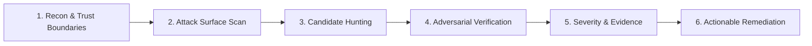

# Syupeo Security Audit Skill (Cloudflare Architecture)

Dokumen skill ini mengadopsi metodologi audit keamanan multi-fase dari **Cloudflare (`security-audit-skill`)** yang diadaptasikan khusus untuk ekosistem **Syupeo**: Admin Web (Next.js 16 App Router), Backend Supabase (PostgreSQL RLS), dan Aplikasi Kasir Flutter.

Skill ini mencegah spekulasi palsu (*false positive*) melalui pendekatan **Adversarial Verification** (menguji dan membuktikan hipotesis kerentanan sebelum melaporkannya).

---

## 1. Alur Kerja 6 Fase (Cloudflare State Machine)



### Fase 1: Reconnaissance & Pemetaan Batas Kepercayaan (Trust Boundaries)
Identifikasi batas isolasi data antar entitas:
- **Tamu / Publik**: Rute `/login`, landing page, checkout toko online publik.
- **Kasir / Staf**: Akses input order, buka/tutup shift, cetak struk (terikat `outlet_id`).
- **Owner Toko (Merchant)**: Akses katalog, harga beli/HPP, laporan omzet (terikat `business_id`).
- **Mitra / Marketer**: Akses dashboard komisi dan tautan referal (terikat `partner_id`).
- **Super Admin**: Akses master lisensi offline, CRM, daftar seluruh bisnis (`role = 'super_admin'`).
- **Offline / Local Device**: SQLite kasir, file printer serial, mesin kasir tanpa internet.

---

### Fase 2: Pemetaan Permukaan Serangan (Attack Surface Mapping)

1. **Next.js Web Surface (`admin_web/`)**:
   - Seluruh Server Actions (`'use server'`) di `src/app/**/actions.ts`.
   - Route Handlers di `src/app/api/**/route.ts`.
   - Middleware guard di `src/middleware.ts` / `src/lib/supabase/middleware.ts`.
   - Form input & parser file (upload Excel katalog produk).
2. **Supabase Database Surface**:
   - Seluruh policy Row Level Security (RLS) di tabel multi-tenant.
   - Fungsi database tersimpan (`SECURITY DEFINER` RPC) seperti `is_admin()`, `get_current_partner_id()`.
3. **Flutter POS Surface (`lib/`)**:
   - Penyimpanan kredensial sesi lokal (`flutter_secure_storage` vs `SharedPreferences`).
   - Validasi lisensi offline (HMAC-SHA256 integrity & clock tampering).
   - Antrian sinkronisasi transaksi offline (`client_id` idempotency).

---

### Fase 3: Pencarian Kandidat Kerentanan (Candidate Hunting)

Fokus pada 6 vektor kerentanan kritis Syupeo:

#### A. Otorisasi Server Actions & IDOR (Insecure Direct Object Reference)
- **Cek:** Apakah setiap Server Action memanggil fungsi pembatas hak akses sebelum mutasi?
  ```typescript
  // WAJIB ADA di setiap aksi mutasi server:
  await assertAuthorizedAdmin(); // untuk Super Admin
  // ATAU
  await assertAuthorizedMerchant(businessId); // untuk Owner Toko
  ```
- **Kandidat Kerentanan:** Memodifikasi `business_id` atau `outlet_id` di argumen tanpa mencocokkan sesi login pengguna saat ini.

#### B. Kebocoran Kunci Rahasia (Secret Key Exposure)
- **Cek:** Apakah ada `KOSANKU_SUPABASE_SERVICE_ROLE_KEY`, `SUPABASE_SERVICE_ROLE_KEY`, atau `GEMINI_API_KEY` yang terekspos ke bundle client (`NEXT_PUBLIC_*`) atau file git?
- **Kandidat Kerentanan:** Menggunakan secret key di Client Component (`'use client'`).

#### C. Isolasi Multi-Tenant Supabase (RLS Policy Audit)
- **Cek:** Apakah ada tabel yang memiliki `USING (true)` atau tidak memeriksa kepemilikan tenant?
  ```sql
  -- DILARANG (Bypass RLS):
  CREATE POLICY "Public read" ON businesses FOR SELECT USING (true);

  -- BENAR (Tenant Scoped):
  CREATE POLICY "Owner isolation" ON businesses FOR SELECT
    USING (owner_user_id = auth.uid() OR public.is_admin());
  ```

#### D. Keamanan Lisensi Offline (Anti-Tampering)
- **Cek:** Apakah proses hashing HMAC-SHA256 untuk Serial Key lisensi offline diproses di server?
- **Kandidat Kerentanan:** Algoritma lisensi atau secret salt bocor di kode client JavaScript atau file `.dart`.

#### E. Idempotensi & Replay Attack Sinkronisasi Kasir
- **Cek:** Saat mesin kasir online kembali dan mengirim antrian offline, apakah Supabase mencegah transaksi ganda menggunakan kolom `client_id` unik (UUID)?

#### F. Injeksi & Sanitasi
- **Cek:** Apakah ada query RPC Supabase dinamis tanpa parameter tersanitasi? Apakah render Markdown/HTML menggunakan sanitasi aman (`react-markdown` aman, `dangerouslySetInnerHTML` dilarang)?

---

### Fase 4: Adversarial Verification (Uji Sanggahan Mandiri)
Sebelum menyatakan suatu temuan sebagai kerentanan nyata, lakukan **pembuktian terbalik**:
1. *Dapatkah penyerang tanpa login memicu endpoint ini?* (Periksa apakah `middleware.ts` sudah memblokir rute sebelum fungsi dieksekusi).
2. *Dapatkah merchant A mengakses data merchant B?* (Periksa apakah RLS Supabase otomatis menolak query meskipun API dipanggil langsung via cURL).
3. *Apakah input yang dikirim dibatasi oleh tipe TypeScript dan validator Zod/Supabase?*

> **Aturan Emas Cloudflare:** Jika suatu kandidat berhasil ditangkal oleh lapisan keamanan lain (misal: RLS PostgreSQL menolak query meski server action lupa memeriksa session), tandai sebagai **"Defense-in-Depth Improvement"**, bukan Critical Vulnerability.

---

### Fase 5: Klasifikasi & Skoring Keparahan (Severity Scoring)

| Level | Kriteria Dampak | Waktu Mitigasi |
|---|---|---|
| **CRITICAL** | Akses Super Admin tanpa auth, pencurian data seluruh merchant, bypass bayar/lisensi | Segera (< 24 jam) |
| **HIGH** | Akses data lintas tenant (IDOR), eksekusi Server Action admin oleh kasir biasa | < 48 jam |
| **MEDIUM** | Kebocoran data non-sensitif, ketiadaan rate-limiting pada rute login/OTP | Sprint berjalan |
| **LOW** | Kurang headers keamanan HTTP (CSP, HSTS), log debug yang terlalu verbose | Terjadwal |

---

## 2. Cara Menjalankan Audit Keamanan di Antigravity

Saat pengguna meminta audit keamanan (`/security`, "audit kode", atau "cek celah keamanan"):

1. **Jalankan Reconnaissance & Scan:**
   - Telusuri `admin_web/src/app/api/**` dan `admin_web/src/app/**/actions.ts`.
   - Telusuri tabel dan fungsi SQL di `supabase/migrations/` atau `.agents/skills/dpos-supabase-backend/`.
   - Telusuri penyimpanan token dan session di `lib/core/services/` dan `lib/core/supabase/`.
2. **Dokumentasikan Temuan dengan Format Laporan Cloudflare:**
   - **ID**: `SEC-001`
   - **Komponen**: `admin_web / supabase / flutter`
   - **Tingkat Keparahan**: `Critical / High / Medium / Low`
   - **Titik Rawan (File & Baris)**: `[path/to/file.ts#L10-L25](file:///...)`
   - **Skenario Risiko**: Bagaimana celah dapat dimanfaatkan.
   - **Bukti Adversarial**: Hasil pengujian apakah celah terlindung atau lolos.
   - **Rekomendasi Perbaikan (Diff Code)**: Solusi perbaikan konkrit.

