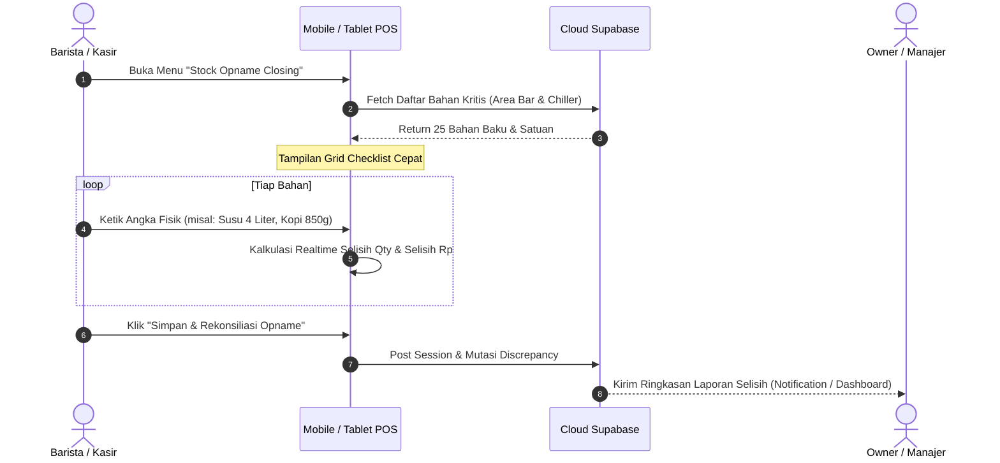
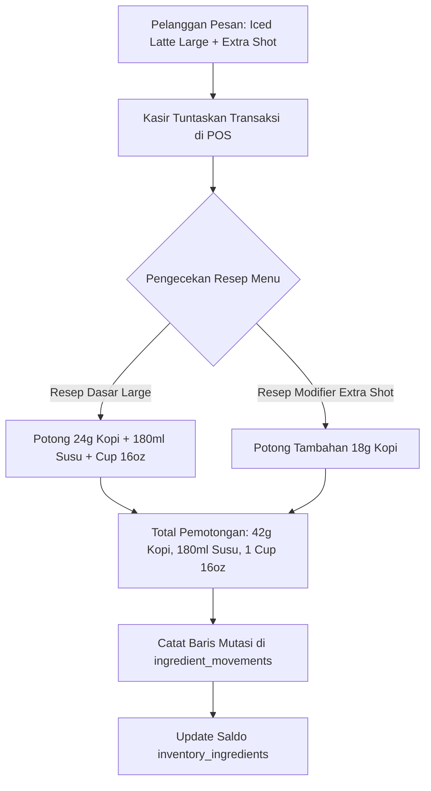

# 🍽️ Master Blueprint & Analisis Sistem: Inventori & Stock Opname F&B
**Mangga POS (Mobile App, Tablet, Web Backoffice, & Cloud Supabase)**  
*Dokumen Spesifikasi Teknis, Audit Kesenjangan (Gap Analysis), Skema Database, dan Panduan Implementasi*  
*Versi: 1.0 | Tanggal: Oktober 2026*

---

## 📑 Daftar Isi
1. [Latar Belakang & Karakteristik Pasar F&B](#1-latar-belakang--karakteristik-pasar-fb)
2. [Audit Komparatif: Kondisi Saat Ini (As-Is) vs Kebutuhan F&B (To-Be)](#2-audit-komparatif-kondisi-saat-ini-as-is-vs-kebutuhan-fb-to-be)
3. [6 Pilar Fitur Krusial F&B yang Harus Dibangun](#3-6-pilar-fitur-krusial-fb-yang-harus-dibangun)
   - [Pilar 1: Lembar Stock Opname Masal (Closing Opname Sheet)](#pilar-1-lembar-stock-opname-masal-closing-opname-sheet)
   - [Pilar 2: Resep Varian, Ukuran Cup & Modifier / Topping (BOM Kustomisasi)](#pilar-2-resep-varian-ukuran-cup--modifier--topping-bom-kustomisasi)
   - [Pilar 3: Konversi Multi-Satuan UOM (Beli Dus → Gudang Liter → Resep ml)](#pilar-3-konversi-multi-satuan-uom-beli-dus--gudang-liter--resep-ml)
   - [Pilar 4: Bahan Setengah Jadi & Olahan Dapur (Kitchen Prep / Sub-Recipes)](#pilar-4-bahan-setengah-jadi--olahan-dapur-kitchen-prep--sub-recipes)
   - [Pilar 5: Modul Waste, Spoilage, Rusak & Jatah Karyawan (Staff Meal)](#pilar-5-modul-waste-spoilage-rusak--jatah-karyawan-staff-meal)
   - [Pilar 6: Deduct Resep Mode Offline & Sinkronisasi Cloud Supabase](#pilar-6-deduct-resep-mode-offline--sinkronisasi-cloud-supabase)
4. [Rancangan Skema Database PostgreSQL (Supabase DDL)](#4-rancangan-skema-database-postgresql-supabase-ddl)
5. [Alur Bisnis & User Flow (Wireframe Logic)](#5-alur-bisnis--user-flow-wireframe-logic)
6. [Tahapan Eksekusi Bertahap (Action Roadmap)](#6-tahapan-eksekusi-bertahap-action-roadmap)

---

## 1. Latar Belakang & Karakteristik Pasar F&B

Industri Food & Beverage (F&B) di Indonesia (Kedai Kopi, Cafe, Restoran, Warmindo, Gerai Minuman Boba, Bakery, hingga Franchise Kuliner) memiliki karakteristik operasional yang sangat berbeda dengan toko retail kelontong biasa:

1. **Barang yang Dijual BUKAN Barang yang Dibeli:**  
   Toko retail membeli rokok 1 slop dan menjual rokok 1 bungkus (1-to-1).  
   Bisnis F&B membeli karung kopi, karton susu, dan jeriken sirup, lalu **mengolahnya menjadi ratusan menu berbeda** (1-to-Many).
2. **Margin Keuntungan Sangat Tipis Terhadap Gramasi (Portion Control):**  
   Kelebihan 3 gram bubuk kopi atau 20 ml susu per cup pada 500 transaksi per hari setara dengan kebocoran omzet jutaan rupiah setiap bulan.
3. **Masa Simpan Singkat (Perishable / Spoilage):**  
   Bahan segar seperti susu pasteurisasi, buah, daging, dan santan memiliki umur simpan pendek (2–5 hari). Bahan terbuang (*waste*) yang tidak tercatat selalu menjadi penyebab utama selisih stok siluman.
4. **Waktu Opname yang Kritis & Terbatas:**  
   Saat pergantian shift kasir atau tutup toko malam hari (closing), staf lelah dan butuh metode opname yang **cepat (maksimal 5–10 menit), berbasis checklist, dan bebas ribet**.

---

## 2. Audit Komparatif: Kondisi Saat Ini (As-Is) vs Kebutuhan F&B (To-Be)

| Aspek / Modul | Kondisi Saat Ini di Mangga POS (As-Is) | Standar Kebutuhan F&B (To-Be) | Tingkat Urgensi |
| :--- | :--- | :--- | :--- |
| **Stock Opname** | Penyesuaian stok hanya bisa per 1 item (`StockAdjustmentScreen` & edit stok tunggal). Lambat dan tidak praktis untuk closing. | **Opname Sheet (Lembar Checklist Masal):** 1 layar tabel seluruh bahan berurutan lokasi fisik (Chiller, Bar, Gudang). Otomatis hitung selisih qty & kerugian Rp. Dukung *Blind Opname*. | 🔴 **Sangat Tinggi (P1)** |
| **Resep Menu (BOM)** | Terikat kaku pada level produk induk (`menu_item_id`). | **Resep Bertingkat:** Mendukung varian (Reguler/Large), tipe penyajian (Hot/Ice), dan Topping/Modifier (Extra Shot, Ganti Oatmilk, Boba). | 🔴 **Sangat Tinggi (P1)** |
| **Satuan Bahan (UOM)** | Hanya 1 kolom `base_unit` (misal: gram, ml). User harus hitung konversi matematika sendiri. | **Konversi Satuan:** Beli satuan besar (Dus/Kg), simpan satuan gudang (Botol/Liter), pakai satuan resep (ml/gram) secara otomatis. | 🟠 **Tinggi (P2)** |
| **Pencatatan Waste / Basi** | Masuk ke adjustment umum, tidak ada klasifikasi alasan legal. | **Formulir Waste & Spoilage Khusus:** Kategori basi, tumpah, salah buat, tester, dan staff meal dengan jejak audit nama karyawan. | 🟠 **Tinggi (P2)** |
| **Bahan Setengah Jadi (Prep)** | Belum ada, bahan mentah diasumsikan langsung terpotong saat menu terjual. | **Kitchen Prep / Sub-Recipes:** Masak Simple Syrup Aren, Kaldu Ramen, Saus Barbeque memotong bahan mentah dan menambah stok sirup matang. | 🟡 **Menengah (P3)** |
| **Offline-First Resep** | Pemotongan resep hanya jalan online. Jika transaksi saat offline, bahan baku tidak terpotong saat disinkronkan ke Supabase. | **Offline Resep Engine:** Saat sinkronisasi offline orders, mutasi bahan baku otomatis dihitung dan dipotong di database cloud. | 🔴 **Sangat Tinggi (P1)** |
| **Editor Resep Web Admin** | Resep baru bisa diatur via aplikasi Mobile/Tablet. Belum ada di `admin_web`. | **Web Admin Recipe Builder:** Owner lebih leluasa mengetik gramasi resep dan HPP di laptop dengan layar lebar. | 🟠 **Tinggi (P2)** |

---

## 3. 6 Pilar Fitur Krusial F&B yang Harus Dibangun

### Pilar 1: Lembar Stock Opname Masal (Closing Opname Sheet)
Fitur ini adalah **fitur wajib nomor 1** yang dicari oleh manager cafe dan supervisor resto:
1. **Sesi Opname Terjadwal:**
   - Sesi Opname Tutup Shift (Harian): Hanya bahan kritis (Kopi, Susu, Sirup, Cup).
   - Sesi Opname Mingguan / Bulanan: Seluruh gudang dan bahan pendukung.
2. **Antarmuka Input Cepat (Quick Keypad Grid):**
   - Daftar bahan diurutkan berdasarkan **Storage Location** (misal: Chiller Bar Depan $\rightarrow$ Rak Sirup $\rightarrow$ Gudang Kering).
   - Kolom: `Nama Bahan` | `Satuan` | `Stok Teori Sistem` | `Input Fisik Riil` | `Selisih (Variance)` | `Nilai Kerugian (Rp)`.
   - Tombol *Next / Enter* otomatis pindah ke baris berikutnya tanpa perlu tap berkali-kali.
3. **Blind Opname Mode (Pencegahan Fraud):**
   - Opsi setting toko: Sembunyikan kolom "Stok Sistem" dari staf kasir/barista, sehingga staf wajib menghitung fisik dengan jujur dan tidak asal menyamakan angka.
4. **Rekonsiliasi 1-Klik:**
   - Setelah selesai diisi, tombol **"Selesaikan & Rekonsiliasi Opname"** otomatis:
     - Mengubah saldo stok menjadi angka fisik.
     - Mencatat mutasi selisih ke tabel `ingredient_movements` bertipe `adj_opname`.
     - Menghasilkan ringkasan laporan selisih untuk persetujuan Owner.

---

### Pilar 2: Resep Varian, Ukuran Cup & Modifier / Topping (BOM Kustomisasi)
Resep F&B modern bersifat dinamis mengikuti pilihan pelanggan:
1. **Resep Ukuran / Varian:**
   - Menu: *Kopi Susu Gula Aren*
     - Varian **Regular (12oz):** 18g Kopi, 120ml Susu UHT, 20ml Gula Aren, 1 Cup 12oz, 1 Lid Datar.
     - Varian **Large (16oz):** 24g Kopi, 180ml Susu UHT, 30ml Gula Aren, 1 Cup 16oz, 1 Lid Datar, 1 Sedotan.
2. **Resep Modifier / Add-on:**
   - Pelanggan memilih Add-on **"Extra Espresso Shot (+Rp 5.000)":**
     - Otomatis memotong tambahan `18g Biji Kopi Espresso`.
   - Pelanggan memilih opsi **"Ganti Susu Oat (+Rp 10.000)":**
     - Mengurangi pemakaian Susu Sapi UHT sebanyak `-120ml`.
     - Menambah pemakaian Susu Oatmilk sebanyak `+120ml`.
3. **Pengaruh Terhadap HPP (Recipe Cost):**
   - HPP menu dasar otomatis dihitung ulang secara modular per kombinasi varian dan topping yang dipilih.

---

### Pilar 3: Konversi Multi-Satuan UOM (Beli Dus → Gudang Liter → Resep ml)
Mengatasi kerumitan matematika desimal di lapangan:
1. **Master Satuan (UOM):**
   - Satuan Beli (*Purchase Unit*): Dus, Karton, Sak 25kg, Tray 30 butir, Jeriken 5L.
   - Satuan Gudang (*Storage Unit*): Botol 1L, Pack 1kg, Pcs.
   - Satuan Resep (*Recipe Unit*): ml, gram, butir, lembar.
2. **Matriks Konversi Otomatis:**
   - Contoh Susu: `1 Dus = 12 Liter = 12.000 ml`.
   - Ketika staf mencatat pembelian: *"Beli 2 Dus Susu @ Rp 216.000"*:
     - Sistem otomatis menambah stok bahan baku sebesar `+24.000 ml`.
     - Menghitung HPP per ml dasar: `Rp 432.000 / 24.000 ml = Rp 18/ml`.
     - Staf tidak perlu menghitung pembagian secara manual.

---

### Pilar 4: Bahan Setengah Jadi & Olahan Dapur (Kitchen Prep / Sub-Recipes)
Resto dan kafe tidak menggunakan bahan mentah secara langsung untuk banyak menu:
1. **Konsep Sub-Recipe:**
   - Produk: **Sirup Gula Aren Matang (Semi-Finished)**
     - Resep Masak: 2 kg Gula Aren Batok + 1.5 Liter Air Bersih + 3 Lembar Daun Pandan.
     - Hasil Jadi (*Output Yield*): Menghasilkan **2.500 ml Sirup Aren Siap Pakai**.
2. **Eksekusi Batch Prep (Work Order Sederhana):**
   - Saat dapur masak, staf tap tombol **"Catat Olahan: Sirup Aren (1 Batch)"**.
   - Sistem otomatis:
     - Memotong stok `2 kg Gula Aren Batok` dan `3 Lembar Daun Pandan`.
     - Menambah stok `2.500 ml Sirup Gula Aren Matang`.
     - Menghitung HPP rata-rata sirup aren per ml berdasarkan harga bahan mentah yang dipakai.

---

### Pilar 5: Modul Waste, Spoilage, Rusak & Jatah Karyawan (Staff Meal)
Mencegah saling tuduh antara owner dan karyawan terkait barang hilang:
1. **Formulir Catat Waste Harian:**
   - Dapat diakses langsung dari POS Tablet atau HP kasir.
   - Input: Bahan Baku $\rightarrow$ Jumlah Terbuang $\rightarrow$ Alasan.
2. **Kategori Alasan Legal:**
   - `Basi / Expired`: Susu dibuka lewat 3 hari, santan mengental asam.
   - `Tumpah / Salah Racik`: Minuman terjatuh, pesanan salah buat.
   - `Rusak Fisik`: Telur pecah, kemasan bocor saat pengiriman.
   - `Staff Meal`: Jatah makan dan minum barista/koki harian.
   - `Complimentary / Komplain`: Penggantian menu gratis untuk komplain pelanggan.
3. **Laporan Audit Kerugian:**
   - Owner dapat memantau grafik bulanan: *"Berapa rupiah bahan baku yang terbuang karena basi vs tumpah?"*.

---

### Pilar 6: Deduct Resep Mode Offline & Sinkronisasi Cloud Supabase
Menjaga keandalan offline-first Mangga POS:
1. **Tantangan Saat Ini:**
   - Jika kasir offline, pesanan disimpan di SQLite lokal. Saat ini pemotongan bahan baku di cloud hanya terjadi jika transaksi dilakukan secara online.
2. **Solusi Arsitektur:**
   - Tambahkan tabel lokal `local_ingredient_recipes` di SQLite (caching data resep).
   - Saat pesanan offline di-upload oleh `OfflineSyncService` ke Supabase, backend function (atau sync handler) otomatis menjalankan pemotongan bahan baku untuk transaksi tersebut berdasarkan resepnya, sehingga angka stok bahan di cloud tetap sinkron 100%.

---

## 4. Rancangan Skema Database PostgreSQL (Supabase DDL)

Berikut tabel-tabel baru dan penyempurnaan skema untuk mendukung sistem inventori F&B terpadu:

```sql
-- ==============================================================================
-- 1. TABEL SESI STOCK OPNAME MASAL
-- ==============================================================================
CREATE TABLE IF NOT EXISTS stock_opname_sessions (
    id UUID PRIMARY KEY DEFAULT gen_random_uuid(),
    business_id UUID NOT NULL REFERENCES businesses(id) ON DELETE CASCADE,
    outlet_id UUID NOT NULL REFERENCES outlets(id) ON DELETE CASCADE,
    session_number VARCHAR(64) NOT NULL, -- Contoh: OP-20261021-001
    status VARCHAR(32) NOT NULL DEFAULT 'draft', -- 'draft', 'in_progress', 'completed', 'cancelled'
    opname_type VARCHAR(32) NOT NULL DEFAULT 'daily_closing', -- 'daily_closing', 'weekly', 'full_monthly'
    notes TEXT,
    total_system_value DECIMAL(15, 2) DEFAULT 0,
    total_physical_value DECIMAL(15, 2) DEFAULT 0,
    total_discrepancy_value DECIMAL(15, 2) DEFAULT 0, -- Selisih kerugian dalam Rupiah
    started_at TIMESTAMPTZ DEFAULT NOW(),
    completed_at TIMESTAMPTZ,
    conducted_by UUID REFERENCES auth.users(id),
    approved_by UUID REFERENCES auth.users(id),
    created_at TIMESTAMPTZ DEFAULT NOW(),
    updated_at TIMESTAMPTZ DEFAULT NOW()
);

-- ==============================================================================
-- 2. RINCIAN BARANG PADA SESI OPNAME (OPNAME ITEMS)
-- ==============================================================================
CREATE TABLE IF NOT EXISTS stock_opname_items (
    id UUID PRIMARY KEY DEFAULT gen_random_uuid(),
    session_id UUID NOT NULL REFERENCES stock_opname_sessions(id) ON DELETE CASCADE,
    ingredient_id UUID REFERENCES inventory_ingredients(id) ON DELETE CASCADE,
    menu_item_id UUID REFERENCES menu_items(id) ON DELETE CASCADE,
    item_name VARCHAR(255) NOT NULL,
    storage_location VARCHAR(64) DEFAULT 'General', -- 'Chiller', 'Meja Bar', 'Gudang Belakang'
    unit VARCHAR(32) NOT NULL,
    system_stock DECIMAL(12, 3) NOT NULL DEFAULT 0,
    physical_stock DECIMAL(12, 3) NOT NULL DEFAULT 0,
    discrepancy_quantity DECIMAL(12, 3) GENERATED ALWAYS AS (physical_stock - system_stock) STORED,
    unit_cost DECIMAL(15, 2) NOT NULL DEFAULT 0,
    discrepancy_value DECIMAL(15, 2) GENERATED ALWAYS AS ((physical_stock - system_stock) * unit_cost) STORED,
    discrepancy_reason VARCHAR(64), -- 'spoilage', 'damaged', 'unrecorded_use', 'theft', 'count_error'
    notes TEXT,
    counted_at TIMESTAMPTZ DEFAULT NOW()
);

-- ==============================================================================
-- 3. RESEP MODULAR (DUKUNGAN VARIAN & MODIFIER / TOPPING)
-- ==============================================================================
-- Menambahkan kolom variant_id dan modifier_id ke tabel resep
ALTER TABLE menu_item_recipes 
ADD COLUMN IF NOT EXISTS variant_id UUID REFERENCES menu_item_variants(id) ON DELETE CASCADE,
ADD COLUMN IF NOT EXISTS modifier_option_id UUID, -- Jika ada pilihan topping / add-on
ADD COLUMN IF NOT EXISTS notes VARCHAR(128);

-- ==============================================================================
-- 4. PENCATATAN BAHAN RUSAK / TERBUANG (WASTE & SPOILAGE LOGS)
-- ==============================================================================
CREATE TABLE IF NOT EXISTS inventory_waste_logs (
    id UUID PRIMARY KEY DEFAULT gen_random_uuid(),
    business_id UUID NOT NULL REFERENCES businesses(id) ON DELETE CASCADE,
    outlet_id UUID NOT NULL REFERENCES outlets(id) ON DELETE CASCADE,
    ingredient_id UUID NOT NULL REFERENCES inventory_ingredients(id) ON DELETE CASCADE,
    quantity DECIMAL(12, 3) NOT NULL,
    unit VARCHAR(32) NOT NULL,
    unit_cost DECIMAL(15, 2) NOT NULL DEFAULT 0,
    total_loss_cost DECIMAL(15, 2) GENERATED ALWAYS AS (quantity * unit_cost) STORED,
    waste_reason VARCHAR(64) NOT NULL, -- 'expired', 'spilled', 'wrong_preparation', 'staff_meal', 'complimentary'
    notes TEXT,
    reported_by UUID REFERENCES auth.users(id),
    created_at TIMESTAMPTZ DEFAULT NOW()
);

-- ==============================================================================
-- 5. KONVERSI MULTI-SATUAN (UOM CONVERSIONS)
-- ==============================================================================
CREATE TABLE IF NOT EXISTS ingredient_uom_conversions (
    id UUID PRIMARY KEY DEFAULT gen_random_uuid(),
    ingredient_id UUID NOT NULL REFERENCES inventory_ingredients(id) ON DELETE CASCADE,
    from_unit VARCHAR(32) NOT NULL,  -- Contoh: 'Karton'
    to_unit VARCHAR(32) NOT NULL,    -- Contoh: 'Liter' atau 'ml'
    multiplier DECIMAL(12, 4) NOT NULL, -- Contoh: 1 Karton = 12 Liter (multiplier = 12)
    is_purchase_default BOOLEAN DEFAULT FALSE,
    created_at TIMESTAMPTZ DEFAULT NOW()
);

-- ==============================================================================
-- 6. OLAHAN DAPUR / PREP BATCHING (SUB-RECIPES)
-- ==============================================================================
CREATE TABLE IF NOT EXISTS kitchen_prep_batches (
    id UUID PRIMARY KEY DEFAULT gen_random_uuid(),
    business_id UUID NOT NULL REFERENCES businesses(id) ON DELETE CASCADE,
    outlet_id UUID NOT NULL REFERENCES outlets(id) ON DELETE CASCADE,
    target_ingredient_id UUID NOT NULL REFERENCES inventory_ingredients(id), -- Bahan hasil jadi (misal: Sirup Aren)
    quantity_produced DECIMAL(12, 3) NOT NULL,
    unit VARCHAR(32) NOT NULL,
    calculated_total_cost DECIMAL(15, 2) NOT NULL DEFAULT 0,
    notes TEXT,
    prepared_by UUID REFERENCES auth.users(id),
    created_at TIMESTAMPTZ DEFAULT NOW()
);
```

---

## 5. Alur Bisnis & User Flow (Wireframe Logic)

### Alur 1: Closing Opname Harian (Barista / Kasir Tutup Toko)



### Alur 2: Transaksi Menu dengan Resep Kustom (Varian + Topping)



---

## 6. Tahapan Eksekusi Bertahap (Action Roadmap)

Untuk menjaga momentum dan memberikan dampak langsung ke merchant, pengerjaan dibagi menjadi 3 fase:

### 🚀 FASE 1: Quick Wins & Critical Core (Target Minggu Ini)
> **Fokus:** Mengatasi rasa sakit terbesar saat closing toko dan kustomisasi menu.

1. **Migrasi Database Tahap 1:**
   - Buat tabel `stock_opname_sessions` dan `stock_opname_items`.
   - Tambahkan `variant_id` pada tabel `menu_item_recipes`.
2. **Layar Stock Opname Checklist (Mobile POS & Tablet):**
   - Layar input masal berbasis tabel cepat (*quick keypad*).
   - Tampilan perbandingan: Stok Sistem vs Fisik, Selisih Qty, dan Kerugian Rp.
   - Tombol posting rekonsiliasi yang langsung memperbarui stok.
3. **Editor Resep Menu di Admin Web (`admin_web`):**
   - Halaman pembuatan dan penyesuaian resep menu langsung di portal browser owner.
4. **Dukungan Resep Varian:**
   - Hubungkan varian menu (Regular/Large) ke takaran resep yang berbeda.

---

### 📦 FASE 2: Kontrol Kerusakan & Konversi Satuan (Target Minggu Berikutnya)
> **Fokus:** Akurasi belanja dan pencegahan kecurigaan selisih stok.

1. **Formulir Catat Waste & Spoilage:**
   - Input cepat bahan rusak/basi/tumpah/staff meal di HP kasir.
   - Grafik laporan kerugian bahan baku di Admin Web.
2. **Konversi Satuan UOM Otomatis:**
   - Setting konversi: 1 Dus = 12 Liter = 12.000 ml.
   - Input belanja otomatis mengisi stok dasar resep.
3. **Laporan Audit Food Cost & Variance:**
   - Laporan perbandingan: Seharusnya habis berapa vs Riil fisik habis berapa.

---

### 🧠 FASE 3: Advanced Prep & Offline Sync (Pengembangan Lanjutan)
> **Fokus:** Resto skala menengah dan jaringan multi-outlet.

1. **Kitchen Prep & Sub-Recipe Engine:**
   - Pencatatan olahan dapur (Sirup, Kaldu, Bumbu Racik).
2. **Offline-First Deduction Sync:**
   - Integrasi pemotongan bahan otomatis saat sinkronisasi pesanan offline.
3. **AI Restock & Expiry Prediction:**
   - Peringatan cerdas saat bahan mendekati masa kedaluwarsa atau stok menipis sebelum akhir pekan.

---
*Dokumen ini menjadi acuan resmi perancangan dan implementasi fitur inventori F&B Mangga POS.*
