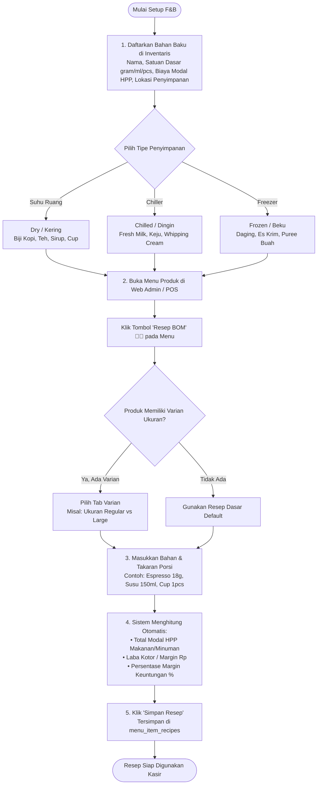
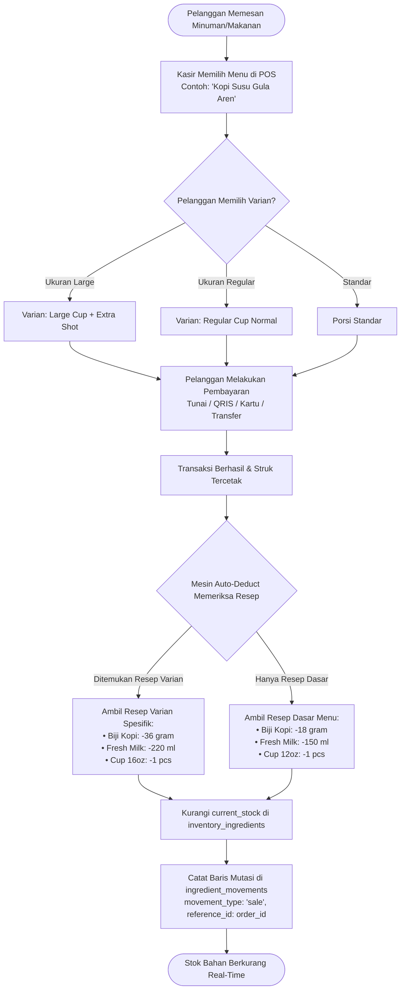

# 🥭 PANDUAN LENGKAP & FLOWCHART ALUR PENGGUNAAN
# F&B INVENTORY, RESEP MODULAR (BOM), & STOCK OPNAME SYSTEM
**Mangga POS (Mobile / Tablet POS & Web Admin)**

Dokumen ini berisi panduan alur operasional, arsitektur data, dan diagram alur (*flowcharts*) lengkap untuk pemilik bisnis (*Owner*), manajer/supervisor (*SPV*), serta kasir/barista/kitchen dalam mengelola bahan baku, resep makanan/minuman modular per varian, hingga audit stok fisik harian (*Stock Opname*).

---

## 📌 DAFTAR ISI
1. [Struktur Peran Pengguna (User Roles)](#1-struktur-peran-pengguna-user-roles)
2. [Pilar Sistem Inventaris F&B Mangga POS](#2-pilar-sistem-inventaris-fb-mangga-pos)
3. [Flowchart 1: Alur Setup Bahan Baku & Resep BOM Modular per Varian](#3-flowchart-1-alur-setup-bahan-baku--resep-bom-modular-per-varian)
4. [Flowchart 2: Alur Transaksi Kasir & Pengurangan Stok Otomatis (Auto-Deduction)](#4-flowchart-2-alur-transaksi-kasir--pengurangan-stok-otomatis-auto-deduction)
5. [Flowchart 3: Alur Daily Closing & Lembar Stock Opname Masal (Mass Opname Sheet)](#5-flowchart-3-alur-daily-closing--lembar-stock-opname-masal-mass-opname-sheet)
6. [Flowchart 4: Alur Pencatatan Bahan Rusak / Basi (Waste & Spoilage)](#6-flowchart-4-alur-pencatatan-bahan-rusak--basi-waste--spoilage)
7. [Panduan Langkah Penggunaan di Aplikasi](#7-panduan-langkah-penggunaan-di-aplikasi)
   - [A. Mengatur Resep BOM di Web Admin](#a-mengatur-resep-bom-di-web-admin-appmudahkanonline)
   - [B. Menjalankan Stock Opname di Web Admin](#b-menjalankan-stock-opname-di-web-admin)
   - [C. Menjalankan Stock Opname di Mobile/Tablet POS](#c-menjalankan-stock-opname-di-mobiletablet-pos)
8. [Standar Operasional Prosedur (SOP) Industri F&B Anti-Bocor](#8-standar-operasional-prosedur-sop-industri-fb-anti-bocor)

---

## 1. STRUKTUR PERAN PENGGUNA (USER ROLES)

| Peran | Perangkat Utama | Tanggung Jawab Utama | Akses Fitur |
|---|---|---|---|
| **Owner / Manajemen** | Web Admin (`app.mudahkan.online`) / Tablet | • Menentukan harga beli & HPP bahan baku<br>• Menyusun resep porsi (BOM) per varian menu<br>• Menganalisis laporan kerugian (*food loss / waste*) | Penuh (Akses Semua Toko, HPP, Resep, Audit Log, Rekonsiliasi) |
| **Store Manager / Supervisor** | Tablet POS & Web Admin | • Mengawasi pengadaan (*restock*) bahan<br>• Memverifikasi hasil hitung fisik staf<br>• Melakukan approval rekonsiliasi opname | Akses Inventaris Outlet, Stock Opname, Koreksi Stok |
| **Kasir / Barista / Kitchen** | Mobile / Tablet POS | • Melayani transaksi kasir (auto-deduct)<br>• Menghitung fisik bahan saat closing (*Blind Count*)<br>• Melaporkan bahan tumpah/basi (*waste log*) | Akses Kasir, Lembar Hitung Opname (Blind Mode) |

---

## 2. PILAR SISTEM INVENTARIS F&B MANGGA POS

```mermaid
graph TD
    subgraph P1[Pilar 1: Resep Modular BOM]
        A1[Bahan Baku Pokok<br>Kopi, Susu, Sirup, Cup] --> A2[Resep Varian Regular]
        A1 --> A3[Resep Varian Large]
        A2 & A3 --> A4[Kalkulasi Otomatis HPP & Margin %]
    end

    subgraph P2[Pilar 2: Auto-Deduction Transaksi]
        B1[Kasir Input Pesanan] --> B2{Cek Varian Terpilih}
        B2 -->|Ada Varian| B3[Potong Resep Varian Spesifik]
        B2 -->|Tanpa Varian| B4[Potong Resep Dasar Menu]
        B3 & B4 --> B5[Catat Log Mutasi di ingredient_movements]
    end

    subgraph P3[Pilar 3: Lembar Stock Opname Masal]
        C1[Closing Harian / Mingguan] --> C2[Mode Blind Count<br>Stok Sistem Dirahasiakan]
        C2 --> C3[Hitung Fisik per Area<br>Bar, Chiller, Freezer]
        C3 --> C4[Hitung Selisih Qty & Valuasi Kerugian Rp]
        C4 --> C5[1-Klik Rekonsiliasi Otomatis & Sync Cloud]
    end
```



---

## 3. FLOWCHART 1: ALUR SETUP BAHAN BAKU & RESEP BOM MODULAR PER VARIAN

Diagram ini menjelaskan bagaimana pemilik usaha mendaftarkan bahan mentah hingga menyusun resep per ukuran cup / varian menu:



---

## 4. FLOWCHART 2: ALUR TRANSAKSI KASIR & PENGURANGAN STOK OTOMATIS (AUTO-DEDUCTION)

Diagram ini menggambarkan alur kerja di kasir ketika pelanggan memesan menu, dan bagaimana inventaris berkurang secara *real-time*:



---

## 5. FLOWCHART 3: ALUR DAILY CLOSING & LEMBAR STOCK OPNAME MASAL (MASS OPNAME SHEET)

Diagram ini adalah alur standar operasional saat tutup toko (*closing shift*) untuk mencegah kebocoran bahan baku:

```mermaid
flowchart TD
    MulaiClosing([Akhir Shift / Closing Toko]) --> BukaOpname[Buka 'Lembar Stock Opname Masal'<br>di Tablet POS atau Web Admin]
    BukaOpname --> PilihTipe[Pilih Jenis Opname:<br>• Closing Harian (Bar & Kitchen)<br>• Mingguan (Weekly Check)<br>• Bulanan Penuh (Full Audit)]
    
    PilihTipe --> SetBlindCount{Aktifkan Mode Blind Count?}
    SetBlindCount -->|Ya (Rekomendasi Staf)| SembunyikanStok[Angka Stok Sistem Disembunyikan<br>Staf menghitung murni secara objektif]
    SetBlindCount -->|Tidak (Owner/Manager)| TampilkanStok[Tampilkan Kolom Stok Sistem]

    SembunyikanStok & TampilkanStok --> FilterArea[Pilih Filter Area Penyimpanan:<br>Kering / Chiller / Freezer]
    
    FilterArea --> HitungFisik[Staf Menghitung Fisik Bahan Baku<br>Input angka ke kolom 'Stok Fisik']
    HitungFisik --> OpsiIsiCepat{Mau Cepat untuk Bahan Pas?}
    OpsiIsiCepat -->|Klik 'Isi Sesuai Sistem'| AutoFill[Semua terisi sesuai sistem,<br>staf cukup ubah yang selisih saja]
    OpsiIsiCepat -->|Input Manual| ManualFill[Ketik angka langsung / tombol +/-]

    AutoFill & ManualFill --> LiveVariance[Sistem Menghitung Selisih Secara Live:<br>• Selisih Unit: Fisik - Sistem<br>• Valuasi Rupiah: Selisih x HPP Satuan<br>• Total Kerugian / Surplus Finansial Rp]

    LiveVariance --> CekSelisih{Ada Bahan yang Selisih?}
    CekSelisih -->|Ya, Ada Selisih| PilihAlasan[Pilih Alasan Discrepancy:<br>• Basi / Expired<br>• Rusak / Tumpah<br>• Pemakaian Tak Tercatat<br>• Kesalahan Hitung]
    CekSelisih -->|Tidak Ada Selisih| LanjutRekonsiliasi[Status: Sesuai / Normal]

    PilihAlasan & LanjutRekonsiliasi --> CatatanSesi[Tulis Catatan Sesi Opname & Verifikasi SPV]
    CatatanSesi --> KlikRekonsiliasi[Klik 'Selesaikan & Rekonsiliasi Otomatis']

    KlikRekonsiliasi --> ProsesDB[1. Simpan sesi ke stock_opname_sessions<br>2. Simpan rincian ke stock_opname_items<br>3. Perbarui current_stock di inventaris<br>4. Catat mutasi adjustment di ingredient_movements]
    ProsesDB --> SelesaiOpname([Inventaris Tersinkronisasi & Laporan Siap Diunduh])
```

---

## 6. FLOWCHART 4: ALUR PENCATATAN BAHAN RUSAK / BASI (WASTE & SPOILAGE)

Jika terjadi insiden operasional di tengah jam kerja (misal: susu basi di kulkas, botol sirup pecah, atau bubuk kopi tumpah):

```mermaid
flowchart TD
    Insiden([Terjadi Insiden Bahan Rusak / Basi / Tumpah]) --> BukaWaste[Buka Menu Penyesuaian / Waste Bahan]
    BukaWaste --> PilihBahan[Pilih Bahan Baku yang Rusak]
    PilihBahan --> InputJumlah[Input Jumlah Terbuang & Satuan<br>Contoh: 1.000 ml Fresh Milk]
    InputJumlah --> TentukanKategori{Kategori Kerusakan}
    
    TentukanKategori --> Spoilage[Basi / Kedaluwarsa (Expired)]
    TentukanKategori --> Damaged[Tumpah / Pecah / Rusak Fisik]
    TentukanKategori --> QC[Gagal Uji Rasa / Kalibrasi Barista]

    Spoilage & Damaged & QC --> HitungBiaya[Sistem Otomatis Menghitung Nilai Kerugian:<br>Jumlah x Harga Beli Bahan Baku]
    HitungBiaya --> SimpanLog[Simpan ke inventory_waste_logs & ingredient_movements<br>movement_type: 'waste']
    SimpanLog --> KurangiStok[Stok Langsung Terpotong Sesuai Bahan Rusak]
    KurangiStok --> LaporanWaste([Muncul di Laporan Food Loss Bulanan])
```

---

## 7. PANDUAN LANGKAH PENGGUNAAN DI APLIKASI

### A. Mengatur Resep BOM di Web Admin (`app.mudahkan.online`)
1. Buka browser dan login ke **Web Admin** di [app.mudahkan.online](https://app.mudahkan.online).
2. Di menu navigasi samping, klik **Menu & Produk**.
3. Cari produk minuman atau makanan yang ingin dibuatkan resepnya.
4. Klik tombol ikon topi koki (**Resep BOM 👨‍🍳**) di kolom aksi produk.
5. Pada modal yang muncul:
   - Jika produk memiliki varian (misal: *Hot*, *Ice*, *Large*), pilih **Tab Varian**.
   - Pada dropdown bahan, pilih bahan baku (misal: *Biji Kopi Arabika*).
   - Masukkan takaran porsi (misal: `18` gram).
   - Tambahkan bahan lainnya (misal: *Susu Fresh Milk* `150` ml, *Paper Cup 12oz* `1` pcs).
6. Perhatikan kotak simulator **Total Modal HPP**, **Laba Kotor (Margin Rp)**, dan **Persentase Margin %** yang terhitung secara instan.
7. Klik **Simpan Resep**. Sekarang, setiap kasir menjual menu atau varian ini, bahan-bahan tersebut otomatis terpotong!

---

### B. Menjalankan Stock Opname di Web Admin
1. Masuk ke menu **Inventaris & Stok** di Web Admin.
2. Di bagian pojok kanan atas, klik tombol **Lembar Stock Opname**.
3. Pilih **Tipe Sesi**: *Closing Harian*, *Mingguan*, atau *Bulanan*.
4. Gunakan tab filter penyimpanan (*Kering*, *Chiller*, *Freezer*) untuk memfokuskan audit per pos kerja dapur/bar.
5. Masukkan hasil hitung fisik ke kolom **Stok Fisik (Hasil Hitung)**.
   - *Tips Cepat:* Klik tombol **Isi Sesuai Sistem**, lalu Anda hanya perlu mengoreksi 2 atau 3 bahan yang mengalami selisih!
6. Jika ada selisih, pilih alasan pada dropdown (*Basi/Expired*, *Rusak/Tumpah*, *Pemakaian Tak Tercatat*).
7. Tulis catatan closing, lalu klik **Selesaikan & Rekonsiliasi Otomatis**.
8. Stok bahan di sistem akan seketika di-update ke angka fisik terbaru, dan riwayat selisih tercatat di audit log.

---

### C. Menjalankan Stock Opname di Mobile/Tablet POS
1. Buka aplikasi **Mangga POS** di Tablet kasir atau HP.
2. Di menu utama, pilih menu **Inventaris**.
3. Klik tombol/kartu **Lembar Stock Opname Masal** (*Closing Checklist*).
4. *(Opsional untuk Staf)* Aktifkan toggle **Mode Blind Count** agar angka sistem tidak terlihat oleh barista/kasir, mencegah kecurangan hitung.
5. Pilih tab area (*Suhu Ruang*, *Chiller*, *Freezer*).
6. Masukkan angka fisik menggunakan tombol `+ / -` cepat atau ketik langsung angkanya.
7. Kartu ringkasan di atas akan otomatis menampilkan:
   - **Progress Hitung:** Berapa bahan yang sudah dicek.
   - **Item Selisih:** Berapa bahan yang berbeda dari sistem.
   - **Estimasi Kerugian / Surplus (Rp):** Valuasi rupiah dari selisih tersebut.
8. Klik tombol **Rekonsiliasi & Selesaikan Opname**. Selesai!

---

## 8. STANDAR OPERASIONAL PROSEDUR (SOP) INDUSTRI F&B ANTI-BOCOR

Untuk menjaga *Food Cost* tetap terkontrol di bawah **30% - 35%** dan mencegah selisih misterius:

```
┌────────────────────────────────────────────────────────────────────────┐
│               SOP HARIAN OPERASIONAL KAFE / RESTORAN                  │
├────────────────────────────────────────────────────────────────────────┤
│ 1. PAGI (Opening Shift):                                               │
│    • Cek notifikasi 'Bahan Menipis' di Dashboard POS.                  │
│    • Lakukan restock belanja pasar pagi / terima kiriman supplier.     │
│    • Input stok masuk melalui menu 'Penyesuaian Stok -> Restock'.      │
│                                                                        │
│ 2. SIANG - MALAM (Operational Hours):                                  │
│    • Seluruh pesanan wajib masuk kasir (No Ticket, No Make).           │
│    • Sistem otomatis memotong bahan baku per resep varian.             │
│    • Jika ada bahan tumpah / susu pecah, segera catat di menu Waste.   │
│                                                                        │
│ 3. MALAM (Closing Shift):                                              │
│    • Supervisor menyalakan mode 'Blind Count' di Lembar Opname POS.    │
│    • Barista & Kitchen menimbang/menghitung sisa bahan di bar & kulkas.│
│    • Supervisor meninjau selisih rupiah yang muncul.                   │
│    • Klik 'Rekonsiliasi Otomatis' sebelum kasir tutup shift (Z-Report).│
└────────────────────────────────────────────────────────────────────────┘
```

---

*Dokumen ini merupakan bagian dari spesifikasi resmi Mangga POS F&B Engine.*  
*Versi: 1.0 (Oktober 2026)*
