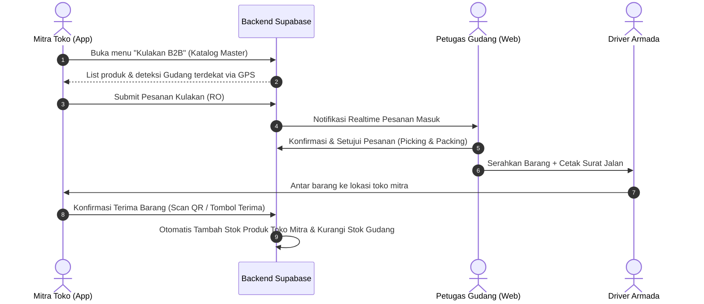
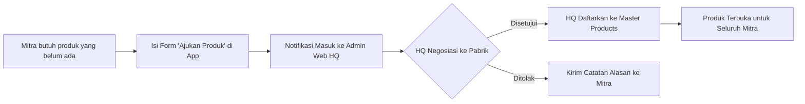

# Product Requirement Document (PRD) & Architecture Blueprint
## Syupeo: Closed-Loop Supply Chain POS & B2B Distribution Ecosystem

**Document Version:** 1.0.0  
**Status:** Approved for Implementation  
**Target Platform:** Flutter Multiplatform (Android/Tablet/Windows), Next.js 16 (Admin Web HQ & Gudang), Supabase PostgreSQL  
**Author:** Syupeo Core Engineering & Business Strategy  

---

## 1. Executive Summary & Visi Bisnis

### 1.1. Latar Belakang & Masalah Pasar
Toko kelontong, retail UMKM, dan warung mandiri menghadapi dua masalah utama:
1. **Sistem Kasir Mahal / Terfragmentasi:** Biaya langganan software kasir POS seringkali memberatkan UMKM kecil.
2. **Rantai Pasok (Supply Chain) Panjang & Mahal:** Pemilik toko harus kulakan barang sendiri ke pasar grosir sub-distributor dengan harga beli tinggi, membuang waktu operasional toko, dan minim daya tawar (*bargaining power*).

### 1.2. Solusi: Closed-Loop Supply Chain POS
Syupeo mentransformasi model bisnis POS tradisional dari sekadar software berbayar menjadi **platform terintegrasi rantai pasok (B2B Supply Chain)**:
* **Bagi Mitra Toko (Merchant):** Mendapatkan sistem POS Kasir modern, QRIS Dinamis, Virtual Soundbox, Manajemen Inventori, dan Toko Online Delivery (`/s/:slug`) **100% GRATIS seumur hidup**.
* **Bagi Syupeo (Platform):** Memperoleh keuntungan utama (*Profit Engine*) dari **selisih harga grosir (supply margin)** pasokan produk langsung dari pabrik/principal ke mitra, bukan dari biaya langganan software kasir.

```text
┌────────────────────────┐      B2B Contract       ┌────────────────────────┐
│  Pabrik / Manufaktur   │ ──────────────────────> │ Syupeo Central Hub(HQ) │
└────────────────────────┘                         └────────────────────────┘
                                                               │
                                                 Alokasi Stok Multi-Gudang
                                                               ▼
┌────────────────────────┐      Order Restock      ┌────────────────────────┐
│ Warung / Toko Mitra    │ <────────────────────── │ Gudang Regional Hub    │
│ (POS Kasir Gratis)     │ (Kirim / Ambil Terdekat)│ (Warehouse Dispatcher) │
└────────────────────────┘                         └────────────────────────┘
            │
  Transaksi Penjualan Kasir / Toko Online
            ▼
┌────────────────────────┐
│ Konsumen Akhir Warga   │
└────────────────────────┘
```

---

## 2. Model Ekosistem & Aturan Bisnis Inti (Core Business Rules)

1. **Gated Product Catalog (Katalog Terkunci):**
   * Mitra **TIDAK BISA** menambah produk sembarangan secara bebas.
   * Katalog produk toko mitra bersumber langsung dari **Master Catalog Syupeo** yang dipasok dari pabrik.
   * Mitra hanya menjual produk yang sudah disetujui dan dialokasikan oleh sistem dari gudang pusat/regional.
2. **Fitur Pengajuan Produk Baru (Product Request):**
   * Jika mitra membutuhkan produk tertentu yang belum ada di katalog, mitra dapat menekan tombol **"Ajukan Produk Baru"** (nama barang, foto kemasan, estimasi harga jual).
   * Tim kurasi HQ akan meninjau dan bernegosiasi langsung dengan vendor/pabrik terkait untuk memasukkan barang tersebut ke katalog master resmi.
3. **Smart Regional Routing (Pemesanan Berbasis Jarak GPS):**
   * Saat mitra melakukan pesanan restock (kulakan), sistem otomatis mendeteksi gudang regional terdekat berdasarkan koordinat GPS outlet mitra (`latitude`, `longitude`).
   * Mitra dapat memilih metode: **Dikirim oleh Armada Syupeo** atau **Ambil Sendiri di Gudang (Self Pick-up)**.
4. **Metode Pembayaran Kulakan (Settlement Terms):**
   * **Tier 1 (Cash on Delivery / Transfer):** Mitra membayar lunas barang saat barang sampai di toko.
   * **Tier 2 (Tempo / Konsinyasi Terpantau):** Untuk mitra terpercaya dengan histori transaksi POS bagus, diberikan fasilitas limit piutang (*Credit Limit*) dengan pembayaran berkala (H+7 atau H+14).

---

## 3. Matriks Peran & Hak Akses (RBAC)

| Peran (Role) | Platform | Hak Akses Utama |
|---|---|---|
| **Super Admin HQ** | Admin Web (`admin_web`) | Manajemen kontrak pabrik, master katalog harga beli & HET, pembuatan gudang baru, alokasi armada, monitoring margin nasional. |
| **Warehouse Staff** | Admin Web (`admin_web`) | Penerimaan barang dari pabrik (*Inbound*), stok opname gudang, proses pesanan mitra (*Picking & Packing*), cetak Surat Jalan & dispatch pengiriman. |
| **Mitra Toko (Owner)** | Flutter App & Web Merchant | POS Kasir, Toko Online, katalog toko, katalog kulakan B2B restock, riwayat PO ke gudang, pengajuan produk baru. DILARANG tambah produk manual. |
| **Kasir Toko** | Flutter App | Transaksi POS offline, barcode scan, terima pembayaran QRIS, cetak struk thermal, buka/tutup shift kasir. |
| **End-Customer** | Web Toko Online (`/s/:slug`) | Lihat produk yang tersedia di toko mitra sekitar, belanja online, pilih ambil di toko atau kurir pengantaran lokal. |

---

## 4. Rancang Bangun Database (Supabase PostgreSQL Schema)

Skema database berikut ditambahkan di atas skema POS dasar untuk mengaktifkan kapabilitas Closed-Loop Supply Chain:

```sql
-- 1. Gudang Regional / Fulfillment Hub
CREATE TABLE IF NOT EXISTS public.warehouses (
    id UUID PRIMARY KEY DEFAULT gen_random_uuid(),
    code TEXT UNIQUE NOT NULL, -- Contoh: 'WH-JKT-01'
    name TEXT NOT NULL,
    address TEXT NOT NULL,
    latitude DOUBLE PRECISION NOT NULL,
    longitude DOUBLE PRECISION NOT NULL,
    coverage_radius_km NUMERIC(5, 2) DEFAULT 25.0,
    pic_name TEXT NOT NULL,
    pic_phone TEXT NOT NULL,
    is_active BOOLEAN NOT NULL DEFAULT TRUE,
    created_at TIMESTAMPTZ NOT NULL DEFAULT timezone('utc'::text, now())
);

-- 2. Master Katalog Produk Nasional (Pusat / Pabrik)
CREATE TABLE IF NOT EXISTS public.master_products (
    id UUID PRIMARY KEY DEFAULT gen_random_uuid(),
    sku TEXT UNIQUE NOT NULL,
    barcode TEXT UNIQUE,
    name TEXT NOT NULL,
    brand TEXT,
    category_id UUID REFERENCES public.categories(id),
    description TEXT,
    image_url TEXT,
    package_unit TEXT NOT NULL DEFAULT 'Pcs', -- Pcs, Pack, Karton, Dus
    pcs_per_package INT NOT NULL DEFAULT 1,
    factory_buy_price INT NOT NULL, -- Modal beli Syupeo dari pabrik
    partner_wholesale_price INT NOT NULL, -- Harga jual grosir Syupeo ke mitra
    recommended_retail_price INT NOT NULL, -- HET (Harga Eceran Tertinggi) ke konsumen
    min_order_qty INT NOT NULL DEFAULT 1,
    is_active BOOLEAN NOT NULL DEFAULT TRUE,
    created_at TIMESTAMPTZ NOT NULL DEFAULT timezone('utc'::text, now())
);

-- 3. Stok Produk di Tiap Gudang Regional
CREATE TABLE IF NOT EXISTS public.warehouse_inventories (
    id UUID PRIMARY KEY DEFAULT gen_random_uuid(),
    warehouse_id UUID NOT NULL REFERENCES public.warehouses(id) ON DELETE CASCADE,
    master_product_id UUID NOT NULL REFERENCES public.master_products(id) ON DELETE CASCADE,
    stock_quantity INT NOT NULL DEFAULT 0,
    safety_stock_threshold INT NOT NULL DEFAULT 10,
    updated_at TIMESTAMPTZ NOT NULL DEFAULT timezone('utc'::text, now()),
    UNIQUE(warehouse_id, master_product_id)
);

-- 4. Pengajuan Pesanan Kulakan Mitra ke Gudang (Restock Orders)
CREATE TYPE public.restock_order_status AS ENUM (
    'draft', 
    'submitted', 
    'approved', 
    'packing', 
    'shipping', 
    'delivered', 
    'cancelled'
);

CREATE TABLE IF NOT EXISTS public.restock_orders (
    id UUID PRIMARY KEY DEFAULT gen_random_uuid(),
    order_code TEXT UNIQUE NOT NULL, -- Contoh: 'RO-202610-0012'
    business_id UUID NOT NULL REFERENCES public.businesses(id) ON DELETE CASCADE,
    outlet_id UUID NOT NULL REFERENCES public.outlets(id) ON DELETE CASCADE,
    warehouse_id UUID NOT NULL REFERENCES public.warehouses(id),
    total_amount INT NOT NULL DEFAULT 0,
    payment_terms TEXT NOT NULL DEFAULT 'cod', -- 'cod', 'transfer', 'credit_tempo'
    delivery_method TEXT NOT NULL DEFAULT 'delivery', -- 'delivery', 'pickup'
    shipping_address TEXT,
    shipping_notes TEXT,
    status public.restock_order_status NOT NULL DEFAULT 'submitted',
    driver_name TEXT,
    driver_phone TEXT,
    dispatched_at TIMESTAMPTZ,
    delivered_at TIMESTAMPTZ,
    created_at TIMESTAMPTZ NOT NULL DEFAULT timezone('utc'::text, now())
);

-- 5. Rincian Item Pesanan Restock
CREATE TABLE IF NOT EXISTS public.restock_order_items (
    id UUID PRIMARY KEY DEFAULT gen_random_uuid(),
    restock_order_id UUID NOT NULL REFERENCES public.restock_orders(id) ON DELETE CASCADE,
    master_product_id UUID NOT NULL REFERENCES public.master_products(id),
    quantity INT NOT NULL,
    unit_price INT NOT NULL, -- partner_wholesale_price pada saat order
    subtotal INT NOT NULL,
    created_at TIMESTAMPTZ NOT NULL DEFAULT timezone('utc'::text, now())
);

-- 6. Pengajuan Produk Baru dari Mitra ke HQ
CREATE TABLE IF NOT EXISTS public.product_request_submissions (
    id UUID PRIMARY KEY DEFAULT gen_random_uuid(),
    business_id UUID NOT NULL REFERENCES public.businesses(id) ON DELETE CASCADE,
    outlet_id UUID NOT NULL REFERENCES public.outlets(id) ON DELETE CASCADE,
    product_name TEXT NOT NULL,
    brand_or_vendor TEXT,
    sample_barcode TEXT,
    expected_selling_price INT,
    estimated_monthly_demand INT,
    notes TEXT,
    status TEXT NOT NULL DEFAULT 'pending', -- 'pending', 'reviewing', 'approved_added', 'rejected'
    admin_response_note TEXT,
    created_at TIMESTAMPTZ NOT NULL DEFAULT timezone('utc'::text, now())
);

-- Hubungkan Produk Toko dengan Master Product
ALTER TABLE public.products 
ADD COLUMN IF NOT EXISTS master_product_id UUID REFERENCES public.master_products(id);
```

---

## 5. Alur Operasional (Workflows)

### Alur 1: Kulakan Barang dari Gudang Terdekat


### Alur 2: Pengajuan Produk Baru oleh Mitra


---

## 6. Modifikasi Kode per Layer

### 6.1. Flutter Mobile/Tablet POS (`lib/`)
1. **Modifikasi `products_screen.dart`:**
   * Sembunyikan FAB / Tombol Tambah Produk manual untuk user merchant.
   * Tambahkan tombol **"Ajukan Produk ke Pusat"** yang membuka dialog formulir usulan barang.
2. **Tambah Fitur Baru `lib/features/supply_chain/`:**
   * `presentation/screens/restock_catalog_screen.dart`: Katalog kulakan grosir langsung ke gudang terdekat dengan filter kategori dan pencarian barcode.
   * `presentation/screens/restock_cart_screen.dart`: Keranjang kulakan grosir dengan kalkulasi total belanja dan pemilihan jadwal/opsi pengiriman.
   * `presentation/screens/restock_history_screen.dart`: Pelacakan status pengiriman Surat Jalan dan tombol konfirmasi barang sampai.
3. **Penyelarasan Stok Otomatis:**
   * Saat pesanan restock berstatus `delivered`, sistem otomatis mencocokkan `master_product_id` ke tabel `products` toko mitra dan mengupdate `current_stock`.

### 6.2. Admin Web HQ & Gudang (`admin_web/`)
1. **Rute `/dashboard/master-catalog`:**
   * Manajemen produk pabrik: Upload foto, SKU pabrik, HPP pabrik, harga jual mitra, dan HET.
2. **Rute Baru `/dashboard/warehouses`:**
   * Manajemen gudang: Tambah titik koordinat gudang regional, batas radius jangkauan, dan staf gudang.
3. **Rute Baru `/dashboard/warehouse-dispatch`:**
   * Monitoring pesanan kulakan masuk per gudang.
   * Pembuatan Surat Jalan & Manifest pengiriman armada.
4. **Rute Baru `/dashboard/product-requests`:**
   * Meninjau aspirasi barang dari warung-warung mitra untuk di-follow-up tim purchasing ke vendor terkait.

---

## 7. Roadmap Implementasi Teknis

| Fase | Target Modul | Milestone Output |
|---|---|---|
| **Fase 1: Database Foundation** | PostgreSQL Migrations & RLS | Menjalankan SQL schema `warehouses`, `master_products`, `restock_orders`, dan policy RLS terisolasi. |
| **Fase 2: Mobile Merchant UI** | Flutter `lib/features/supply_chain/` | Penguncian tambah produk bebas, implementasi katalog kulakan grosir & checkout PO ke gudang. |
| **Fase 3: Admin Web Dispatcher** | Next.js 16 `admin_web` | Dashboard manajemen gudang regional, penerimaan pesanan restock, cetak surat jalan. |
| **Fase 4: Pilot Launch** | Operational Field Test | Uji coba di 10 warung mitra percontohan pada 1 radius gudang regional. |

---

*Dokumen ini menjadi rujukan utama arsitektur dan bisnis Syupeo Closed-Loop POS. Tim pengembang dapat langsung mengeksekusi migrasi database dan implementasi fitur berdasarkan spesifikasi di atas.*
