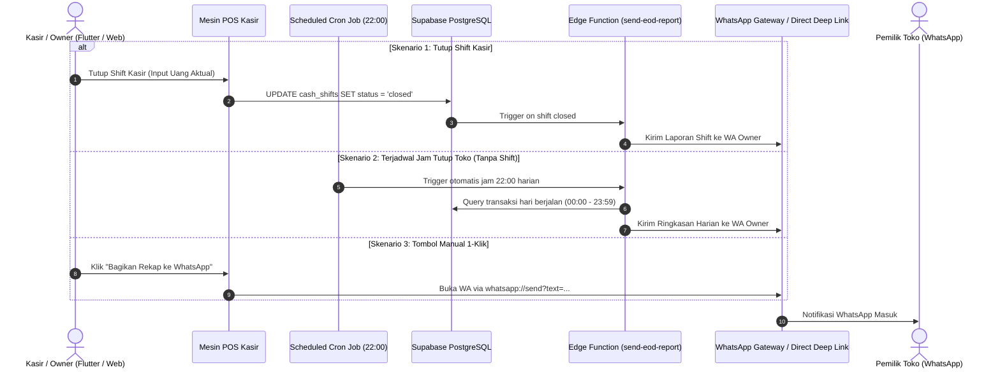

# 🗺️ UMKM Product Roadmap & Arsitektur Solusi P1
**Aplikasi:** Mangga POS (Mobile POS & Web Merchant Portal)  
**Dokumen:** Roadmap Produk & Spesifikasi Konseptual Prioritas 1 (P1)  
**Target Pasar:** UMKM Indonesia (F&B / Kafe, Warung Sembako, Retail Pakaian, Jasa / Laundry / Bengkel)  
**Status:** DRAFT / PROPOSED FOR IMPLEMENTATION  

---

## 📌 1. Latar Belakang & Realitas Lapangan UMKM Indonesia

Dari lebih dari 64 juta pelaku UMKM di Indonesia, mayoritas bisnis skala mikro dan kecil bergulat dengan 3 masalah fatal yang menghambat pertumbuhan:
1. **Kebocoran Arus Kas (Cash Flow Leakage):** Uang pribadi bercampur dengan uang toko, serta banyaknya piutang (kasbon pelanggan) yang tidak tercatat rapi sehingga modal macet.
2. **Ketergantungan Pemilik pada Toko (Lack of Delegation):** Pemilik takut meninggalkan toko karena khawatir kasir mencurangi transaksi (*void* fiktif, selisih kas, diskon liar).
3. **Margin Tergencet & Minim Data Pelanggan:** Bergantung pada platform pihak ketiga dengan potongan komisi 20%–30%, namun tidak memiliki database kontak pelanggan sendiri.

---

## 🎯 2. Matriks Roadmap Produk (P1 – P4)

```
[ P1: Pondasi Kas & Kepercayaan ] ➔ [ P2: Efisiensi & Kontrol Fraud ] ➔ [ P3: Pertumbuhan Omzet 0% ] ➔ [ P4: Akses Permodalan ]
• Buku Kasbon & WA Reminder       • Blind Cash Close (Tutup Buta)     • Katalog WA 0% Komisi         • Laporan KUR Bank 1-Halaman
• Rekap Harian EOD ke WA Owner     • Otorisasi PIN Void Kasir          • QR Standee Meja Mandiri      • Multi-Cabang Konsolidasi
• Deteksi Stok Menipis Cepat       • Burn Rate Alert & Auto-PO         • CRM Broadcast Kupon Promo    • Integrasi Akuntansi Lengkap
```

| Tingkat | Modul Fitur | Nilai Bisnis Nyata bagi UMKM | Target Rilis |
| :--- | :--- | :--- | :--- |
| **P1** | **Buku Kasbon & Piutang Pelanggan Digital** | Mencegah modal macet, menagih hutang pelanggan tanpa canggung via WhatsApp otomatis. | ✅ **SUDAH LIVE (v1.0.14)** |
| **P1** | **Rekap Harian Tutup Toko (EOD) ke WhatsApp Owner** | Pemilik dapat memantau setoran kas, omzet, dan selisih laci dari rumah setiap malam tanpa harus menelepon kasir. | **Sprint 1 (Next Prioritas)** |
| **P2** | **Kontrol Fraud Kasir (Blind Cash Close & PIN Void)** | Mencegah kasir memanipulasi perhitungan laci kasir dan menghapus transaksi tanpa izin pemilik. | Sprint 2 |
| **P2** | **Peringatan Stok Habis (Burn Rate Prediction)** | Memberi rekomendasi kapan harus belanja ke supplier sebelum barang habis. | Sprint 2 |
| **P3** | **Katalog Online 0% Komisi & QR Meja Mandiri** | Web catalog `/s/:slug` & QR meja mandiri agar pelanggan order langsung via WA & POS tanpa potongan ojol 20%. | ✅ **SUDAH LIVE (Web & POS)** |
| **P3** | **Mini CRM Pelanggan & WhatsApp Kupon Promo** | Mendorong pelanggan datang kembali dengan kupon diskon via nomor WA yang tersimpan otomatis saat transaksi. | Sprint 3 |
| **P4** | **Laporan Keuangan 1 Halaman untuk Pengajuan KUR / Bank** | Membantu UMKM mendapatkan pinjaman modal usaha dari bank dengan pembukuan laba-rugi yang valid. | Sprint 4 |

---

## 🚀 3. Konsep Lengkap P1.1: Buku Kasbon & Piutang Pelanggan Digital

### 3.1. Masalah yang Diselesaikan
* Di warung sembako, kafe, toko bahan kue, bengkel, dan laundry, sistem *"bayar tempo / catat di buku dulu"* adalah instrumen utama menjaga loyalitas pelanggan setia.
* Masalahnya: Buku kasbon kertas sering hilang, sobek, tulisan tidak terbaca, pembeli menyangkal jumlah hutang, atau pemilik toko **lupa dan sungkan (canggung)** untuk menagih.
* Akibatnya: **Modal kerja toko habis terpendam di piutang pelanggan**.

### 3.2. Solusi Produk
Menyediakan fitur **Kasbon Terpadu di Mesin Kasir & Backoffice**:
1. Saat checkout di kasir, tersedia opsi pembayaran **"Kasbon / Tempo"**.
2. Kasir memilih nama pelanggan dari database (atau input nama + nomor HP baru dalam 5 detik).
3. Batas Plafon Kasbon (*Credit Limit*): Toko bisa membatasi maksimal hutang per pelanggan (misal: maks Rp 300.000). Jika melebihi plafon, kasir diberi peringatan.
4. Tanggal Jatuh Tempo (*Due Date*): Tanggal janji bayar dicatat.
5. **Pelunasan Fleksibel (Cicilan):** Pelanggan bisa mencicil (misal hutang Rp 100.000, bayar dulu Rp 30.000). Sistem otomatis menghitung sisa piutang.
6. **WhatsApp 1-Click Reminder (Penagihan Santun):** Tombol di kasir dan backoffice untuk mengirimkan rincian tagihan via WhatsApp secara sopan dan otomatis, lengkap dengan rincian barang, tanggal belanja, dan nomor rekening/QRIS toko untuk bayar transfer.

### 3.3. Skema Basis Data (Database Architecture - PostgreSQL / Supabase)

```sql
-- 1. Master Pelanggan Toko (Customers)
CREATE TABLE IF NOT EXISTS public.customers (
    id UUID PRIMARY KEY DEFAULT gen_random_uuid(),
    business_id UUID NOT NULL REFERENCES public.businesses(id) ON DELETE CASCADE,
    name VARCHAR(150) NOT NULL,
    phone VARCHAR(30) NOT NULL,
    address TEXT,
    credit_limit NUMERIC(15,2) DEFAULT 0, -- 0 = Unlimited
    current_debt NUMERIC(15,2) DEFAULT 0,  -- Total sisa hutang berjalan
    notes TEXT,
    created_at TIMESTAMPTZ DEFAULT NOW(),
    updated_at TIMESTAMPTZ DEFAULT NOW()
);

CREATE INDEX IF NOT EXISTS idx_customers_biz_phone ON public.customers(business_id, phone);
CREATE INDEX IF NOT EXISTS idx_customers_debt ON public.customers(business_id, current_debt DESC);

-- 2. Buku Piutang / Kasbon (Customer Debts)
CREATE TABLE IF NOT EXISTS public.customer_debts (
    id UUID PRIMARY KEY DEFAULT gen_random_uuid(),
    business_id UUID NOT NULL REFERENCES public.businesses(id) ON DELETE CASCADE,
    outlet_id UUID NOT NULL REFERENCES public.outlets(id) ON DELETE CASCADE,
    customer_id UUID NOT NULL REFERENCES public.customers(id) ON DELETE RESTRICT,
    order_id UUID REFERENCES public.orders(id) ON DELETE SET NULL, -- Relasi ke transaksi kasir
    invoice_number VARCHAR(50),
    total_amount NUMERIC(15,2) NOT NULL,      -- Nilai transaksi awal yang dihutang
    remaining_amount NUMERIC(15,2) NOT NULL,  -- Sisa hutang saat ini
    due_date DATE,                            -- Tanggal jatuh tempo
    status VARCHAR(20) NOT NULL DEFAULT 'unpaid' 
        CHECK (status IN ('unpaid', 'partially_paid', 'paid', 'bad_debt')),
    notes TEXT,
    created_by UUID REFERENCES auth.users(id) ON DELETE SET NULL,
    created_at TIMESTAMPTZ DEFAULT NOW(),
    updated_at TIMESTAMPTZ DEFAULT NOW()
);

CREATE INDEX IF NOT EXISTS idx_debts_status ON public.customer_debts(business_id, status);
CREATE INDEX IF NOT EXISTS idx_debts_due_date ON public.customer_debts(business_id, due_date);

-- 3. Riwayat Pembayaran / Cicilan Kasbon (Debt Payments)
CREATE TABLE IF NOT EXISTS public.debt_payments (
    id UUID PRIMARY KEY DEFAULT gen_random_uuid(),
    debt_id UUID NOT NULL REFERENCES public.customer_debts(id) ON DELETE CASCADE,
    customer_id UUID NOT NULL REFERENCES public.customers(id) ON DELETE RESTRICT,
    outlet_id UUID NOT NULL REFERENCES public.outlets(id) ON DELETE CASCADE,
    shift_id UUID REFERENCES public.cash_shifts(id) ON DELETE SET NULL, -- Masuk ke shift laci aktif
    amount_paid NUMERIC(15,2) NOT NULL CHECK (amount_paid > 0),
    payment_method VARCHAR(30) NOT NULL DEFAULT 'cash' CHECK (payment_method IN ('cash', 'transfer', 'qris')),
    notes TEXT,
    received_by UUID REFERENCES auth.users(id) ON DELETE SET NULL,
    created_at TIMESTAMPTZ DEFAULT NOW()
);

-- 4. Riwayat Notifikasi Pengingat Tagihan (Debt Reminder Logs)
CREATE TABLE IF NOT EXISTS public.debt_reminders (
    id UUID PRIMARY KEY DEFAULT gen_random_uuid(),
    debt_id UUID NOT NULL REFERENCES public.customer_debts(id) ON DELETE CASCADE,
    sent_to_phone VARCHAR(30) NOT NULL,
    message_content TEXT NOT NULL,
    sent_at TIMESTAMPTZ DEFAULT NOW(),
    sent_by UUID REFERENCES auth.users(id) ON DELETE SET NULL
);
```

### 3.4. Alur Interaksi Pengguna (User Journey)

#### A. Alur Kasir: Pelanggan Beli dengan Kasbon
1. Kasir memasukkan item belanjaan ke keranjang kasir (misal: Total Rp 75.000).
2. Di halaman pembayaran, kasir memilih tombol metode bayar: **[ Kasbon / Catat Hutang ]**.
3. Muncul modal pencarian pelanggan:
   * Ketik nama/nomor HP pelanggan (jika belum ada, klik *"Tambah Pelanggan Cepat"* cukup input Nama & No WA).
   * Sistem menampilkan sisa hutang sebelumnya & batas kredit.
   * Kasir memilih tanggal jatuh tempo (opsi cepat: *+3 Hari*, *+7 Hari*, *+14 Hari*, atau akhir bulan).
4. Klik **Simpan Transaksi**.
5. Struk kasir tercetak dengan keterangan:
   ```text
   STATUS: KASBON / BELUM LUNAS
   Pelanggan: Ibu Siti (0812-xxxx-xxxx)
   Sisa Hutang Toko: Rp 145.000
   Jatuh Tempo: 25 Okt 2026
   ```
6. Opsi langsung kirim struk kasbon ke WhatsApp pelanggan dengan 1 klik.

#### B. Alur Penagihan via WhatsApp (Bebas Canggung & Otomatis)
Kasir atau Pemilik Toko membuka tab **"Buku Kasbon"** di aplikasi Android atau Web Portal:
* Terlihat badge status:
  * 🟢 **Belum Tempo** (Jatuh tempo > 3 hari lagi).
  * 🟡 **Jatuh Tempo Hari Ini**.
  * 🔴 **Lewat Jatuh Tempo / Menunggak** (Overdue).
* Tombol hijau: **[ 💬 Kirim Tagihan WA ]**.
* Template pesan WhatsApp otomatis disusun ramah:

```text
Halo Kak/Ibu *Siti* 🙏,
Semoga sehat dan berkah selalu.

Sekadar mengingatkan rincian catatan belanja di *Toko Berkah Sejahtera*:
• No. Nota: INV-928172
• Tanggal: 16 Okt 2026
• Rincian: Beras 5kg, Telur 1kg, Minyak 2L
• Sisa Tagihan: *Rp 145.000*
• Jatuh Tempo: *25 Okt 2026*

Pembayaran dapat ditransfer via:
💳 BCA: 123-456-7890 (a.n Toko Berkah)
📱 QRIS: (Ketik 'QRIS' untuk kami kirimkan kode QR)
Atau bisa langsung mampir ke toko ya Kak.

Terima kasih banyak atas kepercayaannya berbelanja di tempat kami! 😊🙏
```

#### C. Alur Pelunasan (Bayar Penuh / Cicilan)
1. Pembeli datang ke toko atau transfer bank.
2. Kasir mencari nama pembeli di menu **Buku Kasbon** ➔ Klik **[ Bayar / Lunasi ]**.
3. Kasir memasukkan nominal yang dibayarkan (misal: bayar Rp 50.000 dari total Rp 145.000).
4. Pilih metode pembayaran (*Tunai Laci*, *Transfer*, atau *QRIS*).
   * Jika bayar *Tunai Laci*, otomatis masuk ke perhitungan shift kasir aktif (*cash in*).
5. Sistem memperbarui status: Sisa hutang tersisa Rp 95.000.
6. Kasir bisa mencetak tanda terima pembayaran atau kirim notifikasi tanda lunas via WhatsApp.

---

## 📊 4. Konsep Lengkap P1.2: Laporan Rekap Harian (EOD) Otomatis ke WhatsApp Pemilik

### 4.1. Masalah yang Diselesaikan
* Pemilik UMKM yang memiliki pekerjaan utama atau tidak selalu berada di lokasi toko sering kali cemas:
  * *"Berapa omzet hari ini?"*
  * *"Berapa uang tunai yang seharusnya ada di laci kasir?"*
  * *"Ada pengeluaran kas operasional apa saja tadi?"*
  * *"Apakah ada selisih uang kasir (kurang/lebih)?"*
* Saat ini pemilik harus menelepon kasir malam-malam, meminta kasir memfoto lembaran catatan manual, atau login ke komputer yang merepotkan.

### 4.2. Solusi Produk & Mekanisme Multi-Trigger (Fleksibel untuk Semua UMKM)
Banyak UMKM yang dijaga sendiri oleh pemiliknya atau tidak menerapkan SOP shift kasir yang ketat. Oleh karena itu, sistem menyediakan **3 mekanisme trigger**:

1. **Trigger A: Saat Tutup Shift Kasir (Untuk Toko Ber-SOP Shift):**
   * Dipicu langsung saat kasir menekan *"Tutup Shift Kasir"* di aplikasi POS.
   * Menyertakan rekonsiliasi uang fisik laci kasir vs hitungan sistem.
2. **Trigger B: Terjadwal Otomatis (Scheduled Cron - Untuk Toko Tanpa Shift):**
   * Pemilik mengatur *"Jam Rekap / Tutup Toko"* (misal: pukul `22:00` WIB) di pengaturan toko.
   * Setiap hari pada jam tersebut, sistem otomatis menghitung transaksi hari itu dan mengirimkan ringkasan ke nomor WhatsApp Owner tanpa pemilik/kasir perlu menekan tombol apa pun.
3. **Trigger C: Tombol Manual 1-Klik `[ 📲 Kirim Rekap Hari Ini ke WhatsApp ]`:**
   * Tersedia di layar Laporan Penjualan (Harian) di aplikasi Flutter POS dan Web Backoffice.
   * Kasir/Owner bisa membagikan laporan kapan saja (sore atau malam) langsung membuka aplikasi WhatsApp via `whatsapp://send`.

---

### 4.3. Format Pesan WhatsApp Rekap Harian (EOD WhatsApp Report)

#### Format 1: Toko dengan Sistem Shift Kasir (Ada Rekonsiliasi Laci)
```text
📊 *LAPORAN TUTUP TOKO HARIAN - MANGGA POS*
🏪 *Toko:* Toko Berkah Sejahtera (Outlet Utama)
📅 *Tanggal:* Minggu, 19 Oktober 2026
⏰ *Waktu Tutup:* 22:05 WIB
👤 *Kasir Bertugas:* Rina Andriani
━━━━━━━━━━━━━━━━━━━━

💰 *RINGKASAN PENJUALAN:*
• Total Transaksi: 48 Transaksi
• Penjualan Kotor: Rp 2.850.000
• Diskon Toko: -Rp 120.000
• *PENJUALAN BERSIH: Rp 2.730.000*

💳 *RINCIAN METODE BAYAR:*
• 💵 Tunai Laci: Rp 1.650.000
• 📱 QRIS (Gopay/Shopee/OVO): Rp 880.000
• 🏦 Transfer Bank: Rp 200.000
• 📝 Kasbon Baru: Rp 0

💵 *REKONSILIASI KAS LACI (SHIFT KASIR):*
• Modal Awal Kas: Rp 300.000
• Penjualan Tunai: +Rp 1.650.000
• Kas Masuk Lain: +Rp 0
• Kas Keluar (Beban Operasional): -Rp 85.000
  _(Ket: Beli Es Batu Rp 35rb, Beli Kantong Plastik Rp 50rb)_
• Estimasi Uang Seharusnya di Laci: *Rp 1.865.000*
• Uang Fisik Aktual Dihitung Kasir: *Rp 1.865.000*
• *Status Selisih:* ✅ *PAS (Rp 0 - Tidak Ada Selisih)*

🏆 *TOP 3 PRODUK TERLARIS:*
1. Es Kopi Susu Gula Aren (24 cup)
2. Roti Bakar Coklat Keju (14 porsi)
3. Cireng Crispy Bumbu Rujak (11 porsi)

⚠️ *PERINGATAN STOK MENIPIS:*
• Susu UHT Diamond (Sisa 3 kotak - segera belanja!)

━━━━━━━━━━━━━━━━━━━━
🔗 *Detail Struk & Laporan Lengkap:*
https://app.mudahkan.online/merchant/reports?date=2026-10-19
```

#### Format 2: Toko Tanpa Sistem Shift (Otomatis Jam Tutup / Tombol Manual)
```text
📊 *RINGKASAN PENJUALAN HARIAN - MANGGA POS*
🏪 *Toko:* Toko Berkah Sejahtera
📅 *Tanggal:* Senin, 19 Oktober 2026
⏰ *Waktu Rekap:* 22:00 WIB (Otomatis)
━━━━━━━━━━━━━━━━━━━━

💰 *RINGKASAN OMZET:*
• Total Transaksi: 36 Transaksi
• Penjualan Kotor: Rp 1.950.000
• Diskon: -Rp 50.000
• *TOTAL OMZET BERSIH: Rp 1.900.000*
• Estimasi Laba Kotor: Rp 680.000

💳 *METODE PEMBAYARAN:*
• 💵 Tunai: Rp 1.100.000
• 📱 QRIS: Rp 650.000
• 🏦 Transfer: Rp 150.000
• 📝 Kasbon: Rp 0

🏆 *TOP 3 PRODUK HARI INI:*
1. Kopi Susu Aren (18 cup)
2. Kentang Goreng (9 porsi)
3. Roti Bakar (7 porsi)

⚠️ *PERINGATAN STOK:*
• Sirup Vanilla (Sisa 2 botol)

━━━━━━━━━━━━━━━━━━━━
🔗 *Lihat Laporan Lengkap:*
https://app.mudahkan.online/merchant/reports?date=2026-10-19
```

### 4.4. Arsitektur Teknis Pengiriman WhatsApp EOD



---

## 🛠️ 5. Rencana Tahapan Eksekusi (Sprint Plan)

### Sprint 1.1: Modul Kasbon Digital (Database & Mobile UI)
* [ ] Eksekusi migrasi Supabase: tabel `customers`, `customer_debts`, `debt_payments`, `debt_reminders`.
* [ ] Tambah pilihan metode pembayaran `Kasbon` di kasir POS (`lib/features/transaction`).
* [ ] Buat layar **Buku Kasbon / Piutang Pelanggan** di Flutter POS:
  * Tab: Semua, Belum Lunas, Jatuh Tempo, Lunas.
  * Dialog: Bayar Cicilan / Pelunasan.
  * Tombol: Buka WhatsApp dengan pesan tagihan otomatis (`url_launcher`).

### Sprint 1.2: Buku Kasbon di Web Backoffice (`admin_web`)
* [ ] Tambah menu **Buku Kasbon / Pelanggan** di `admin_web/src/app/merchant/debts/`.
* [ ] Tabel daftar kasbon dengan filter status jatuh tempo.
* [ ] Export daftar piutang ke Excel (*spreadsheet*).

### Sprint 1.3: Laporan Tutup Shift EOD Otomatis via WhatsApp
* [ ] Hubungkan form Tutup Shift kasir dengan pembuat pesan ringkasan.
* [ ] Sediakan tombol cepat: **[ 📲 Kirim Rekap ke WhatsApp Owner ]** di dialog tutup shift.
* [ ] Setup webhook Supabase / Edge Function untuk auto-send saat shift ditutup.

---

## 💡 6. Nilai Jual & Strategi Komunikasi ke Pemilik UMKM

Saat mempromosikan fitur ini ke pemilik toko, jangan gunakan istilah teknis perbankan (seperti *Account Receivable* atau *End of Day Reconciliation*). Gunakan bahasa yang menyentuh masalah harian mereka:

> 💬 *"Pak/Bu, pakai Mangga POS sekarang gak perlu pusing lagi kalau ada langganan yang kasbon. Tinggal catat di kasir, ada pengingat jatuh tempo, dan bisa kirim tagihan ramah lewat WhatsApp tanpa rasa canggung."*

> 💬 *"Mau tinggal toko jalan-jalan atau di rumah? Tenang, setiap kasir tutup toko, laporan omzet bersih, rincian QRIS/Tunai, dan selisih uang laci langsung dikirim otomatis ke WhatsApp HP Bapak/Ibu."*
