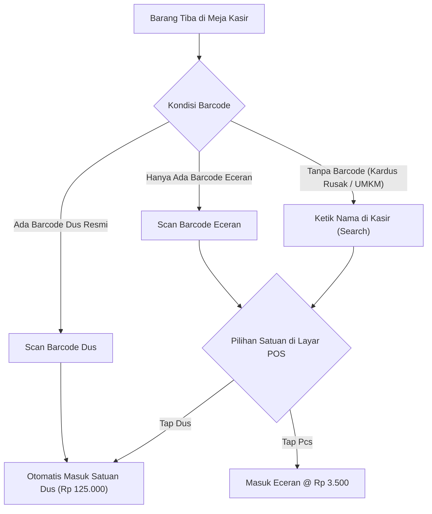

# Spesifikasi Transaksi POS, Inventori Multi-Satuan & Barcode Retail Syupeo

Dokumen ini mendokumentasikan spesifikasi arsitektur bisnis, perlakuan stok inventori, alur barcode, dan kalkulasi transaksi kasir untuk operasional toko retail **Syupeo**.

---

## 1. Latar Belakang & Masalah Lapangan Toko Retail

Di dunia retail (toko kelontong, minimarket, warung sembako, dan agen):
1. **Barang Masuk (Kulakan / Inbound):** Berasal dari Gudang Syupeo / Distributor dalam bentuk satuan kemasan besar (Karton, Dus, Lusin, Renceng, Bal, Slop, Peti).
2. **Barang Keluar (Penjualan / Outbound):** Pembeli akhir (*end-consumer*) bisa membeli dalam bentuk **Karton utuh** (harga grosir) maupun **Eceran** (Pcs, Bungkus, Botol, Sachet).
3. **Isi Kemasan Berbeda-beda (*Packaging Multiplier*):** Setiap jenis barang dan pabrikan memiliki standar isi yang berbeda-beda:
   - **Indomie Goreng:** 1 Dus = **40 Bungkus**
   - **Teh Pucuk Harum 350ml:** 1 Karton = **24 Botol**
   - **Aqua 600ml:** 1 Dus = **24 Botol**
   - **Kopi Kapal Api Sachet:** 1 Renceng = **10 Sachet**, 1 Dus = **12 Renceng (120 Sachet)**
   - **Sabun Mandi Lifebuoy:** 1 Karton = **48 Pcs**
   - **Rokok:** 1 Slop = **10 Bungkus**, 1 Bal = **200 Bungkus**

---

## 2. Arsitektur Inventori: Konsep Satu Stok Induk (*Base Unit*)

Untuk mencegah selisih stok (*stock discrepancy*), sistem Syupeo mencatat stok fisik di database **hanya pada satu nilai induk**, yaitu **Satuan Terkecil / Eceran (*Base Unit*)**.

```text
                     [ DATABASE STOK INDUK TOKO ]
                      Indomie Goreng = 200 Bungkus
                                  │
         ┌────────────────────────┴────────────────────────┐
         ▼                                                 ▼
   Jual Eceran (Pcs)                             Jual Dus (1 Dus = 40 Pcs)
   • Harga Ecer: Rp 3.500                        • Harga Dus: Rp 125.000
   • Potong stok: 1 Pcs                          • Potong stok: 40 Pcs
```

### Rumus Matematis Pengurangan Stok:
$$\text{Stok Berkurang} = \sum (\text{Qty Terjual} \times \text{Multiplier Satuan})$$

* Jika jual 1 Dus ($1 \times 40$) $\rightarrow$ Stok berkurang **40 Pcs**.
* Jika jual 3 Bungkus ($3 \times 1$) $\rightarrow$ Stok berkurang **3 Pcs**.
* Jika jual 1 Dus + 3 Bungkus $\rightarrow$ Stok berkurang **43 Pcs**.

---

## 3. Transaksi Campuran: Beli Karton + Eceran dalam 1 Struk

Kasus nyata di kasir: Pembeli membeli **1 Dus Indomie untuk stok bulanan + 3 Bungkus eceran untuk langsung dimasak**.

### A. Tampilan Keranjang Kasir (Cart State):
Keranjang belanja menampung 2 baris item yang mengacu pada master produk yang sama:
1. `Indomie Goreng (Dus/40)` $\times$ 1 = Rp 125.000
2. `Indomie Goreng (Pcs)` $\times$ 3 = Rp 10.500 (@ Rp 3.500)
- **Total Tagihan:** Rp 135.500

### B. Format Cetak Struk Kasir Thermal (ESC/POS 58mm / 80mm):
```text
========================================
             TOKO MUDAHKAN              
========================================
No: TRX-20261030-001    Kasir: Budi
Tgl: 30 Okt 2026 16:15
----------------------------------------
1x Indomie Goreng (Dus/40)     Rp 125.000
3x Indomie Goreng (Pcs)        Rp  10.500
   (@ Rp 3.500)
----------------------------------------
TOTAL ITEM: 2 Baris (43 Pcs)
TOTAL BAYAR:                   Rp 135.500
TUNAI:                         Rp 150.000
KEMBALI:                       Rp  14.500
========================================
        Terima Kasih & Selamat Belanja  
```

### C. Eksekusi Database (Atomik Transaction):
```sql
-- Pengurangan stok total 43 Pcs secara bersamaan
UPDATE public.menu_items
SET stock_quantity = stock_quantity - 43
WHERE id = 'uuid-indomie-goreng';
```

---

## 4. Kebijakan & Alur Barcode Scanner (Apakah Barcode Wajib?)

**Kesimpulan: TIDAK WAJIB (Sifatnya Opsional / Fleksibel)**

Sistem mengakomodasi 3 skenario nyata di meja kasir:



1. **Skenario 1 — Hanya Barcode Eceran yang Terdaftar (Kasus Paling Sering):**
   - Kasir scan barcode eceran $\rightarrow$ layar kasir memunculkan opsi tombol kilat: `[ Pcs ]` atau `[ Dus ]`.
   - Kasir tap `Dus` $\rightarrow$ langsung masuk 1 dus dan stok terpotong kelipatan isi dus.
2. **Skenario 2 — Kedua Barcode Terdaftar (Dus & Eceran):**
   - Scan kardus luar $\rightarrow$ langsung otomatis masuk satuan Dus.
   - Scan bungkus eceran $\rightarrow$ langsung otomatis masuk satuan Pcs.
   - Kasir tidak perlu menyentuh layar lagi (*Scan & Go*).
3. **Skenario 3 — Tanpa Barcode (Manual):**
   - Untuk produk tanpa barcode (telur kiloan, beras, keripik warung).
   - Kasir menggunakan pencarian nama atau grid katalog layar sentuh.

---

## 5. Alur Kulakan & Penerimaan Barang dari Gudang Syupeo

1. **Penerbitan Surat Jalan / Dispatch:**
   - Gudang Syupeo mengirim Starter Kit atau Restock B2B dalam kemasan karton: misal `5 Dus Indomie Goreng`.
2. **Penerimaan Barang di Aplikasi POS:**
   - Toko membuka menu **Penerimaan Barang / Kulakan**.
   - Toko menekan tombol **"Konfirmasi Terima Barang"**.
   - Sistem membaca nilai `multiplier = 40` $\rightarrow$ otomatis menambahkan **200 bungkus** ke stok toko.
   - Nilai Harga Pokok Penjualan (HPP / Modal) toko tercatat otomatis sesuai harga kulakan Syupeo.

---

## 6. Spesifikasi Struktur Skema Data (Database Model)

### Field Multi-Satuan pada `menu_items` / `master_catalog`:

| Nama Kolom | Tipe Data | Deskripsi | Contoh |
| :--- | :--- | :--- | :--- |
| `unit` / `base_unit` | `VARCHAR(20)` | Satuan terkecil jual eceran | `'Pcs'`, `'Bungkus'`, `'Botol'` |
| `wholesale_unit` | `VARCHAR(20)` | Satuan kemasan besar (kulakan) | `'Karton'`, `'Dus'`, `'Lusin'` |
| `conversion_ratio` | `INTEGER` | Jumlah eceran di dalam 1 kemasan besar | `40`, `24`, `12` |
| `barcode` | `TEXT` | Barcode utama (kemasan eceran) | `'899123456789'` |
| `wholesale_barcode` | `TEXT` (Nullable)| Barcode kemasan luar kardus (opsional)| `'899987654321'` |
| `price` | `INTEGER` | Harga jual eceran (satuan dasar) | `3500` |
| `wholesale_price` | `INTEGER` | Harga jual per karton/dus | `125000` |
| `stock_quantity` | `INTEGER` | Stok fisik total dalam satuan eceran | `200` |

---

## 7. Checklist Implementasi pada Modul Mobile Flutter POS

- [ ] **Search & Scan Controller:** Jika barcode yang di-scan cocok dengan `wholesale_barcode`, otomatis tambahkan item dengan unit grosir.
- [ ] **Unit Selector Dialog:** Saat item eceran dipilih dari layar kasir, sediakan toggle cepat *[ Pcs | Dus ]* jika produk memiliki `conversion_ratio > 1`.
- [ ] **Stock Opname Display:** Pada ringkasan stok, tampilkan kalkulasi ramah manusia: *"Sisa 85 Bungkus (2 Dus + 5 Eceran)"*.
- [ ] **Receipt Template:** Baris struk menyertakan keterangan satuan kemasan `(Dus/40)` agar pembeli transparan mengetahui isi produk.

