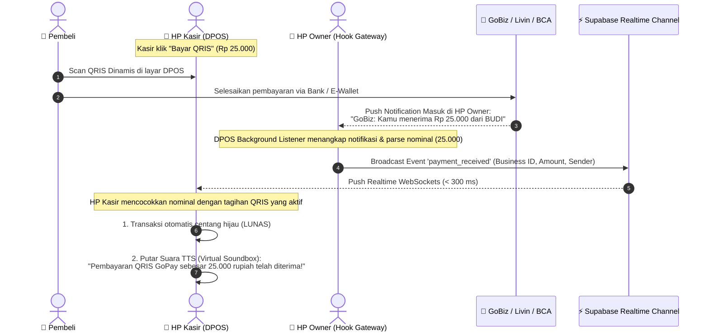
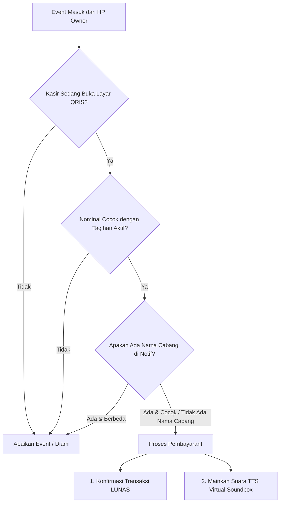

# Dokumentasi Arsitektur: DPOS Virtual Soundbox & Realtime Payment Relay

Dokumen ini mendefinisikan spesifikasi arsitektur, alur data, dan panduan teknis implementasi fitur **Realtime Payment Relay & Virtual Soundbox (TTS)** pada sistem **DPOS (Mangga POS)**.

---

## 1. Latar Belakang & Masalah (Problem Statement)

Di operasional bisnis retail dan F&B (UMKM hingga multi-cabang):
1. **Aplikasi Merchant Bank / E-Wallet** (*GoBiz / GoPay Merchant, Livin Usaha Mandiri, BCA Merchant, OVO Bisnis, ShopeePay*) biasanya terpasang di **HP Owner / Pemilik Usaha**.
2. **Karyawan / Kasir** di outlet melayani transaksi menggunakan **HP / Tablet Kasir** yang terpisah.
3. Demi keamanan rekening dan saldo bisnis, kasir **tidak diberikan akses login** ke aplikasi perbankan/GoBiz owner.
4. **Masalah yang timbul:**
   - Saat pembeli membayar via QRIS, kasir tidak tahu apakah dana sudah benar-benar masuk atau belum.
   - Kasir sering harus menelepon/chat WhatsApp ke Owner untuk konfirmasi atau meminta screenshot mutasi.
   - Membeli atau menyewa alat fisik **Soundbox** dari bank/e-wallet membebankan biaya sewa bulanan dan deposit alat.

### 💡 Solusi: DPOS Virtual Soundbox & Payment Relay
- Menjadikan **HP yang memiliki aplikasi Merchant (misal HP Owner)** sebagai **"Payment Gateway Hook"**.
- HP Owner membaca notifikasi uang masuk di latar belakang (*background listener*).
- HP Owner menyiarkan (*relay*) event pembayaran ke cloud via **Supabase Realtime Broadcast**.
- **HP Kasir** yang sedang membuka tagihan QRIS langsung menangkap sinyal tersebut:
  1. Transaksi langsung terkonfirmasi **Lunas Otomatis**.
  2. HP Kasir membunyikan suara **Text-to-Speech (TTS) Soundbox**: *"Pembayaran QRIS GoPay sebesar dua puluh lima ribu rupiah telah diterima!"*

---

## 2. Arsitektur Sistem & Alur Kerja (Workflow)



---

## 3. Komponen Peran Perangkat (Device Roles)

Pengguna dapat menentukan fungsi perangkat di menu **Pengaturan Pembayaran & Notifikasi**:

| Peran Perangkat | Deskripsi | Perilaku Aplikasi |
| :--- | :--- | :--- |
| **Mode Kasir (Default)** | Perangkat kasir di meja pembayaran | • Mendengarkan event dari Supabase Realtime.<br/>• Hanya bereaksi jika sedang membuka popup QRIS.<br/>• Memutar suara TTS Soundbox saat dana masuk. |
| **Mode Hook / Gateway (HP Owner)** | Perangkat tempat aplikasi GoBiz / Livin terpasang | • Mengaktifkan Android `NotificationListenerService`.<br/>• Memfilter aplikasi bank/e-wallet yang diizinkan.<br/>• Meneruskan event ke Supabase Realtime secara instan. |
| **Mode Mandiri (All-in-One)** | 1 HP untuk Kasir sekaligus GoBiz | • Menangkap notifikasi lokal dan langsung memproses transaksi di perangkat yang sama. |

---

## 4. Spesifikasi Payload Komunikasi (Supabase Realtime)

Relay komunikasi menggunakan fitur **Supabase Realtime Broadcast** (berbasis WebSocket murni tanpa membebani penulisan ke database PostgreSQL).

### Channel Identifier:
```text
realtime:payment_relay:{business_id}
```

### Event: `payment_received`
Payload JSON:
```json
{
  "id": "e4b52df3-89a1-432a-bc81-80a5fcf4591a",
  "business_id": "b3e09886-f495-46ae-953a-c56e300642fa",
  "outlet_id": "a1b2c3d4-...", 
  "detected_outlet_name": "Tebet",
  "app_name": "GoPay Merchant",
  "package_name": "com.gojek.app",
  "amount": 25000,
  "sender": "BUDI SANTOSO",
  "raw_title": "GoBiz - Outlet Tebet",
  "raw_content": "Kamu menerima pembayaran sebesar Rp 25.000 dari BUDI SANTOSO",
  "timestamp": "2026-10-29T16:15:00.000Z"
}
```

---

## 5. Logika Pencocokan & Pencegahan Bentrok (Collision Handling)

Di HP Kasir, penanganan event uang masuk diproses dengan aturan ketat agar tidak salah lunas:



1. **Kasir yang Idle / Beda Nominal = 100% Diam**:
   Kasir yang sedang tidak di halaman pembayaran atau tagihannya berbeda (misal kasir sedang tagihan Rp 50.000 tapi yang masuk Rp 25.000) tidak akan membunyikan suara atau memproses apapun.
2. **Pencocokan Nama Cabang**:
   Jika notifikasi merchant memuat nama cabang (contoh: *"GoBiz - DPOS Tebet: Uang masuk..."*), HP kasir mencocokkan dengan nama outlet aktif.
3. **Pencocokan Nama Pengirim (Opsional / Manual Fallback)**:
   Jika terjadi kondisi langka di mana 2 cabang menagih nominal kembar di detik yang sama, kasir dapat melihat nama pengirim (`sender`) di layar untuk validasi.

---

## 6. Mesin Suara Virtual Soundbox (Text-to-Speech)

Menggunakan dependency [`flutter_tts`](file:///Users/diyanto/dpos/pubspec.yaml#L67) yang sudah terintegrasi di DPOS:

### Format Ucapan Natural (Bahasa Indonesia):
```dart
// Contoh format nominal ramah pendengaran:
// Rp 25.000 -> "dua puluh lima ribu rupiah"
final speechText = 'Pembayaran QRIS $appName sebesar ${terbilangRupiah(amount)} rupiah telah diterima.';
```

### Konfigurasi Suara:
- Bahasa: `id-ID` (Bahasa Indonesia)
- Speech Rate: `0.85` (kecepatan jelas dan tidak terlalu cepat)
- Pitch: `1.0` (nada standar)
- Volume: `1.0` (maksimal)
- Suara dapat di-preview langsung di halaman pengaturan DPOS.

---

## 7. Rencana Modifikasi File di DPOS

1. **[`lib/core/services/payment_notification_service.dart`](file:///Users/diyanto/dpos/lib/core/services/payment_notification_service.dart)**:
   - Tambahkan fungsi `broadcastPaymentToCloud(DetectedPaymentEvent event)` untuk HP Owner.
   - Tambahkan listener `subscribeToCloudPayments(String businessId)` untuk HP Kasir.
2. **[`lib/core/services/payment_notification_models.dart`](file:///Users/diyanto/dpos/lib/core/services/payment_notification_models.dart)**:
   - Tambahkan enum `DevicePaymentRole { cashierOnly, gatewayOwner, both }`.
   - Tambahkan properti `enableTtsSoundbox` dan `ttsVolume`.
3. **[`lib/features/transaction/presentation/widgets/qris_display_modal.dart`](file:///Users/diyanto/dpos/lib/features/transaction/presentation/widgets/qris_display_modal.dart)**:
   - Hubungkan trigger event masuk langsung ke pemanggilan `TextToSpeechService`.
4. **[`lib/features/settings/presentation/views/payment_notification_settings_screen.dart`](file:///Users/diyanto/dpos/lib/features/settings/presentation/views/payment_notification_settings_screen.dart)**:
   - Tambahkan kartu konfigurasi Peran Perangkat (Mode Kasir vs Mode Hook Gateway Owner).
   - Tambahkan toggle dan tombol uji coba suara Virtual Soundbox (TTS Test).
