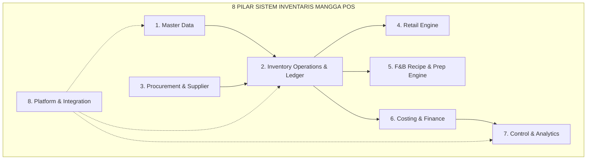
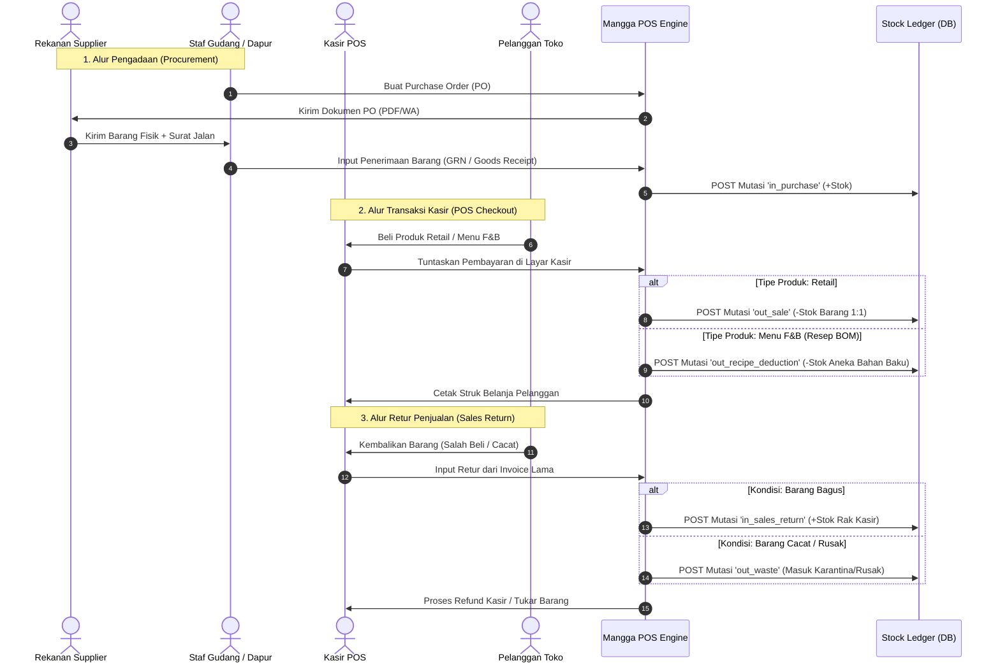

# 📦 PRD & Master Blueprint: Sistem Inventaris Terpadu (Retail & F&B)
**Mangga POS Ecosystem (Mobile POS, Tablet, Web Admin, Supabase Cloud Engine)**  
*Dokumen Spesifikasi Standar Industri & Taksonomi 8 Pilar (Versi 2.0)*

---

## 📑 Daftar Isi
1. [Latar Belakang & Filosofi Arsitektur](#1-latar-belakang--filosofi-arsitektur)
2. [Taksonomi 8 Pilar Inventaris Mangga POS](#2-taksonomi-8-pilar-inventaris-mangga-pos)
   - [Pilar 1: Master Data (Data Induk)](#pilar-1-master-data-data-induk)
   - [Pilar 2: Inventory Operations (Operasional Stok & Ledger)](#pilar-2-inventory-operations-operasional-stok--ledger)
   - [Pilar 3: Procurement (Pengadaan & Supplier)](#pilar-3-procurement-pengadaan--supplier)
   - [Pilar 4: Retail Specialization](#pilar-4-retail-specialization)
   - [Pilar 5: F&B Specialization (Recipe, Kitchen & Prep)](#pilar-5-fb-specialization-recipe-kitchen--prep)
   - [Pilar 6: Costing, Valuation & Finance](#pilar-6-costing-valuation--finance)
   - [Pilar 7: Control, Audit & Advanced Analytics](#pilar-7-control-audit--advanced-analytics)
   - [Pilar 8: Platform, Resilience & System Integration](#pilar-8-platform-resilience--system-integration)
3. [Alur Bisnis End-to-End (Diagram Alir)](#3-alur-bisnis-end-to-end-diagram-alir)
4. [Rancangan Skema Database PostgreSQL (Supabase DDL)](#4-rancangan-skema-database-postgresql-supabase-ddl)
5. [Roadmap & Matriks Prioritas Eksekusi (P1, P2, P3)](#5-roadmap--matriks-prioritas-eksekusi-p1-p2-p3)

---

## 1. Latar Belakang & Filosofi Arsitektur

Mangga POS melayani lanskap bisnis multi-sektor dari skala UMKM satu gerai hingga jaringan waralaba (*chain-store multi-outlet*).  
Untuk memastikan sistem tidak "nanggung" bagi F&B dan tidak "terlalu rumit" bagi Retail, sistem dibangun dengan **Arsitektur 8 Pilar Modular**:



> [!IMPORTANT]
> **Prinsip Utama: "Immutable Stock Ledger"**  
> Dilarang keras memodifikasi angka stok fisik hanya dengan counter langsung (`UPDATE stock = stock - n`).  
> Semua penambahan, pengurangan, retur, tumpah, dan selisih opname **wajib diposting sebagai baris mutasi permanen (*immutable ledger*)** di tabel `inventory_movements` untuk menjamin jejak audit 100% tanpa selisih "siluman".

---

## 2. Taksonomi 8 Pilar Inventaris Mangga POS

### Pilar 1: Master Data (Data Induk)
Pondasi identitas seluruh barang dan entitas gudang.

1. **Product & SKU Management:** Manajemen nomor identitas unik (SKU), barcode, nama barang, status aktif/arsip.
2. **Product Category & Brand:** Pengelompokan berjenjang (Kategori Utama $\rightarrow$ Sub-Kategori) dan merek produk.
3. **Variant & Barcode Matrix:** Manajemen atribut turunan (Warna, Ukuran, Rasa, Model) di mana tiap varian memiliki SKU dan Barcode independen.
4. **Unit of Measure (UOM):** Satuan kuantitas standar (Pcs, Botol, Pack, Dus, Gram, Kilogram, Ml, Liter, Lembar).
5. **Unit Conversion:** Konversi multi-satuan otomatis (contoh: `1 Karton = 24 Pcs`, `1 Bal = 20 Slop`, `1 Kg = 1.000 Gram`).
6. **Product Bundle & Kit:** Paket komposit yang terdiri dari beberapa item sekaligus (misal: Paket Hemat = 1 Burger + 1 Kentang + 1 Minuman).
7. **Batch, Lot & Serial Number:** Pelacakan nomor batch produksi untuk pangan serta pelacakan Serial Number / IMEI unik untuk barang elektronik.
8. **Expiry & Shelf Life:** Pencatatan tanggal kedaluwarsa fisik dan perhitungan sisa masa simpan (*shelf life remaining*).
9. **Supplier & Supplier Product:** Buku kontak rekanan vendor pemasok beserta katalog produk yang mereka suplai.
10. **Warehouse, Zone, Rack & Bin:** Hierarki sub-lokasi fisik barang di toko (Toko Utama $\rightarrow$ Gudang Belakang / Chiller $\rightarrow$ Baris Rak A $\rightarrow$ Kotak/Bin 02).

---

### Pilar 2: Inventory Operations (Operasional Stok & Ledger)
Pencatatan seluruh pergerakan fisik barang di lapangan secara *real-time*.

1. **Stock Ledger & Balance:** Pencatatan mutasi kredit/debit permanen untuk setiap unit barang yang keluar-masuk.
2. **Goods Receipt (Penerimaan Barang):** Penerimaan fisik barang masuk dari pembelian atau suplier.
3. **Goods Issue (Pengeluaran Barang):** Pengeluaran fisik barang untuk operasional, konsumsi internal toko, atau sampel.
4. **Stock Transfer:** Pengiriman stok antargudang atau antaroutlet cabang.
5. **Stock Reservation:** Penguncian alokasi stok untuk pesanan reservasi, meja pre-order, atau pesanan online yang belum lunas (mencegah *overselling*).
6. **Stock Adjustment:** Penyesuaian stok manual yang disertai alasan legal (salah hitung, barang bonus, dll).
7. **Stock Opname & Cycle Count:**
   - *Full Opname:* Penghitungan total stok toko berkala.
   - *Cycle Counting:* Penghitungan bergilir per rak/kategori harian tanpa menghentikan jam operasional kasir.
8. **Stock Reconciliation:** Proses audit untuk mencocokkan selisih antara stok sistem dengan hasil penghitungan fisik opname.
9. **Opening Balance (Saldo Awal):** Inisialisasi awal stok saat toko pertama kali migrasi ke Mangga POS.
10. **Stock In Transit:** Status stok yang telah dikeluarkan dari Cabang Pengirim namun belum dikonfirmasi tiba oleh Cabang Penerima.

---

### Pilar 3: Procurement (Pengadaan & Supplier)
Siklus pembelian barang dagangan dan bahan baku dari vendor.

1. **Purchase Request (PR):** Pengajuan kebutuhan barang dari tim gudang/outlet kepada owner/manajer pembelian.
2. **Purchase Order (PO):** Surat pesanan resmi ke supplier berisikan item, kuantitas, harga kesepakatan, dan tanggal estimasi tiba.
3. **Goods Receipt Note (GRN):** Dokumen bukti penerimaan fisik barang saat suplier mengirimkan pesanan.
4. **Partial Receiving & Backorder:** Penanganan pengiriman bertahap (contoh: dipesan 100 box, baru datang 60 box; sisa 40 box otomatis berstatus *Backorder*).
5. **Purchase Return (Retur Pembelian):** Pengembalian barang cacat/rusak/expired ke supplier disertai klaim tukar guling (*replacement*), nota kredit (*credit note*), atau *cash refund*.
6. **Supplier Price List:** Rekam jejak histori harga beli dari masing-masing supplier untuk negosiasi harga terbaik.
7. **Landed Cost:** Alokasi biaya pengiriman, biaya bongkar muat, atau bea masuk ke dalam Harga Pokok Penjualan (HPP) barang.
8. **Reorder Point (ROP) & Auto Replenishment:** Rekomendasi otomatis kuantitas order ulang berdasarkan *safety stock* dan kecepatan penjualan (*velocity*).

---

### Pilar 4: Retail Specialization
Fitur khusus untuk memaksimalkan operasional toko retail modern.

1. **Retail POS Integration:** Sinkronisasi kasir ultra-cepat dengan pemotongan stok 1:1 saat barcode discan.
2. **Multi-Price & Price List:** Penerapan harga berbeda untuk Pelanggan Reguler, Member/VIP, Eceran, dan Grosir.
3. **Promotion & Bundle:** Diskon bertingkat (*Tiered Pricing*), Buy X Get Y (Beli 2 Gratis 1), Tebus Murah (PWP), dan Flash Sale berbatas waktu.
4. **Variant Matrix:** Antarmuka cepat untuk memilih kombinasi ukuran $\times$ warna dalam 1 layar kasir.
5. **Serial Number & Warranty:** Validasi nomor IMEI/SN saat kasir cetak struk untuk pencatatan masa garansi pelanggan.
6. **Consignment (Konsinyasi):** Pengelolaan barang titipan pihak ketiga, pemisahan stok milik sendiri vs titipan, serta laporan bagi hasil/komisi penjualan.
7. **Omnichannel Inventory:** Sinkronisasi stok antara kasir POS toko fisik, toko online e-commerce Mangga POS (`/s/[namatoko]`), dan marketplace.
8. **Sales Return & Exchange (Retur Penjualan di Kasir):**
   - Validasi nomor faktur/struk lama pelanggan.
   - Klasifikasi barang retur: *Restockable* (kembali ke rak display) vs *Damaged/Bad Stock* (masuk karantina).
   - Pengembalian dana kasir, tukar varian barang, atau penerbitan *Store Credit/Voucher*.
9. **Quick Add Barcode on Scan:** Kasir dapat langsung mendaftarkan nama dan harga barang baru saat barcode belum terdaftar tanpa membatalkan antrean.

---

### Pilar 5: F&B Specialization (Recipe, Kitchen & Prep)
Fitur khusus dapur dan olahan bahan makanan/minuman.

1. **Ingredient & Raw Material:** Master bahan mentah non-menu (Biji kopi, susu, sirup, cup, sendok, beras, telur) yang hanya dikelola oleh gudang/dapur.
2. **Recipe & Bill of Materials (BOM):** Komposisi takaran bahan per 1 porsi menu (misal: 1 cup Kopi Susu = 18g Kopi + 120ml Susu + 25ml Aren + 1 Cup 16oz).
3. **Recipe Versioning:** Histori revisi komposisi resep tanpa merusak data transaksi historis lampau.
4. **Sub-Recipe & Yield:** Pengelolaan bahan setengah jadi (misal: kaldu ramen, adonan pizza, sirup racikan sendiri) dengan kalkulasi *Yield* (penyusutan setelah dimasak/dibersihkan).
5. **Production Order (Work Order Dapur):** Perintah produksi dapur untuk meracik bahan mentah menjadi bahan setengah jadi atau produk bakery jadi.
6. **Prep Planning:** Rencana persiapan harian (*Prep List*) dapur berdasarkan estimasi ramalan penjualan hari tersebut.
7. **Automatic Ingredient Deduction:** Pemotongan otomatis stok bahan baku di balik layar setiap kali kasir menuntaskan transaksi menu di POS.
8. **Waste & Spoilage Tracking:** Pencatatan bahan makanan basi, telur pecah, bahan kedaluwarsa, tumpah, makanan gagal saji, serta jatah makan staf (*staff meal*).
9. **FEFO & Expiry Alert:** Prioritas pemakaian bahan berdasarkan tanggal kedaluwarsa terdekat (*First Expired, First Out*) dan notifikasi alarm bahan mendekati basi.
10. **Food Cost & Portion Control:** Analisis HPP resep makanan secara presisi dan kontrol selisih porsi (*Food Cost Variance*).

---

### Pilar 6: Costing, Valuation & Finance
Perhitungan nilai rupiah persediaan dan integrasi akuntansi.

1. **FIFO Costing (First-In, First-Out):** Barang yang masuk lebih dulu dinilai sebagai modal barang yang keluar lebih dulu.
2. **Moving Weighted Average:** Perhitungan HPP rata-rata bergerak setiap kali ada barang masuk dengan harga beli yang berbeda.
3. **Standard Cost:** Penetapan biaya acuan standar untuk bahan baku F&B.
4. **Inventory Valuation:** Laporan total nilai aset persediaan uang tunai toko yang sedang mengendap dalam bentuk barang di gudang.
5. **COGS (Cost of Goods Sold / HPP) Calculation:** Perhitungan akurat HPP riil per transaksi dan per kategori barang.
6. **Gross Margin Analytics:** Analisis margin keuntungan kotor per menu/produk secara *real-time*.
7. **Stock Write-Off:** Penghapusan nilai buku aset persediaan akibat barang hilang, rusak total, atau kedaluwarsa.
8. **Accounting Journal Integration:** Pemetaan otomatis mutasi stok ke akun jurnal buku besar (Persediaan Barang, HPP, Hutang Dagang, Beban Kerusakan).

---

### Pilar 7: Control, Audit & Advanced Analytics
Pengawasan operasional, pencegahan kecurangan, dan analitik bisnis cerdas.

1. **Approval Workflow:** Pembatasan wewenang untuk tindakan krusial (Koreksi Opname di atas limit tertentu, Penerbitan PO besar, Penghapusan Stok/Write-off wajib persetujuan Owner/PIN Manajer).
2. **Role-Based Access Control (RBAC):** Hak akses berjenjang (Super Admin, Owner, Manager Toko, Kasir, Staf Dapur/Gudang).
3. **Audit Trail (Log Jejak Rekam):** Rekaman permanen: siapa staf yang mengubah stok, kapan waktu perubahan, jenis tindakan, dan alasan perubahan.
4. **Low Stock & Out-of-Stock Alert:** Notifikasi dini saat stok menyentuh titik kritis *Safety Stock*.
5. **Dead Stock & Aging Analysis:** Analisis barang lambat bergerak (*slow-moving*) dan barang mati (*dead stock*) untuk evaluasi promo cuci gudang.
6. **Inventory Turnover Ratio (ITR):** Rasio kecepatan perputaran stok barang dalam kurun waktu tertentu.
7. **Demand Forecasting:** Prediksi kebutuhan stok di masa depan berbasis tren data transaksi historis.
8. **Stock Variance Analysis:** Laporan perbandingan pemakaian bahan teoritis sistem vs sisa fisik aktual untuk mendeteksi kecurangan/kebocoran bahan.
9. **Multi-Outlet Dashboard:** Ringkasan konsolidasi stok seluruh cabang dalam 1 layar komando di Web Admin.
10. **Import & Export:** Export laporan mutasi/stok ke Excel/CSV/PDF dan import massal barang via CSV.

---

### Pilar 8: Platform, Resilience & System Integration
Keandalan infrastruktur teknis, keamanan, dan integrasi ekosistem.

1. **Multi-Company & Multi-Branch:** Satu akun entitas bisnis dapat mengelola banyak brand, perusahaan, dan puluhan cabang mandiri.
2. **REST API & Webhooks:** Jalur integrasi dengan sistem pihak ketiga, marketplace, e-commerce, atau ERP eksternal.
3. **Offline Support & Synchronization:** Kasir tetap bisa bertransaksi dan mencatat mutasi saat internet putus; data tersimpan di SQLite lokal dan otomatis ter-sync ke cloud Supabase begitu online.
4. **Idempotency & Duplicate Prevention:** Mekanisme anti-duplikasi data mutasi stok jika terjadi *retry* jaringan internet yang tidak stabil.
5. **Background Jobs & Triggers:** Pemrosesan kalkulasi resep dan laporan berat di latar belakang tanpa membuat antarmuka kasir macet (*lag-free*).
6. **Notification Center:** Pengiriman notifikasi stok kritis via Push Notification di aplikasi mobile, email, atau WhatsApp gateway.
7. **Report Export Engine:** Mesin generator laporan PDF/CSV berkecepatan tinggi.
8. **Backup & Data Recovery:** Pencadangan data otomatis di cloud Supabase dan pemulihan bencana (*disaster recovery*).

---

## 3. Alur Bisnis End-to-End (Diagram Alir)



---

## 4. Rancangan Skema Database PostgreSQL (Supabase DDL)

Berikut rancangan skema DDL yang mengimplementasikan 8 Pilar di atas secara kokoh:

```sql
-- ============================================================================
-- 1. PILAR MASTER DATA: Bahan Baku & Satuan
-- ============================================================================

CREATE TABLE public.inventory_ingredients (
    id UUID PRIMARY KEY DEFAULT gen_random_uuid(),
    business_id UUID NOT NULL REFERENCES public.businesses(id) ON DELETE CASCADE,
    sku VARCHAR(64),
    name VARCHAR(255) NOT NULL,
    category VARCHAR(100),
    base_unit VARCHAR(32) NOT NULL,           -- 'gram', 'ml', 'pcs'
    purchase_unit VARCHAR(32),                 -- 'kg', 'liter', 'dus'
    conversion_ratio NUMERIC(12, 4) DEFAULT 1.0, -- 1 kg = 1000 gram
    cost_per_base_unit NUMERIC(12, 2) DEFAULT 0.0,
    min_stock_alert NUMERIC(12, 2) DEFAULT 0.0,
    storage_type VARCHAR(32) DEFAULT 'dry',   -- 'dry', 'chilled', 'frozen'
    is_active BOOLEAN DEFAULT TRUE,
    created_at TIMESTAMPTZ DEFAULT NOW(),
    updated_at TIMESTAMPTZ DEFAULT NOW()
);

-- ============================================================================
-- 2. PILAR F&B: Resep Menu (BOM - Bill of Materials)
-- ============================================================================

CREATE TABLE public.menu_item_recipes (
    id UUID PRIMARY KEY DEFAULT gen_random_uuid(),
    business_id UUID NOT NULL REFERENCES public.businesses(id) ON DELETE CASCADE,
    menu_item_id UUID NOT NULL REFERENCES public.menu_items(id) ON DELETE CASCADE,
    ingredient_id UUID NOT NULL REFERENCES public.inventory_ingredients(id) ON DELETE CASCADE,
    quantity_required NUMERIC(12, 4) NOT NULL, -- takaran per porsi (misal 18.0000 gram)
    unit VARCHAR(32) NOT NULL,
    version INT DEFAULT 1,
    created_at TIMESTAMPTZ DEFAULT NOW()
);

-- ============================================================================
-- 3. PILAR UTAMA: Immutable Stock Ledger (Buku Besar Mutasi Stok)
-- ============================================================================

CREATE TABLE public.inventory_movements (
    id UUID PRIMARY KEY DEFAULT gen_random_uuid(),
    business_id UUID NOT NULL REFERENCES public.businesses(id) ON DELETE CASCADE,
    outlet_id UUID NOT NULL REFERENCES public.outlets(id) ON DELETE CASCADE,
    item_type VARCHAR(32) NOT NULL CHECK (item_type IN ('product', 'ingredient')),
    item_id UUID NOT NULL, -- Relasi ke menu_items.id atau inventory_ingredients.id
    movement_type VARCHAR(48) NOT NULL CHECK (
        movement_type IN (
            'opening_balance',       -- Saldo awal
            'in_purchase',           -- Penerimaan barang beli dari supplier
            'out_sale',              -- Penjualan retail kasir
            'out_recipe_deduction',  -- Pengurangan resep menu F&B
            'adj_opname',            -- Penyesuaian stok opname fisik
            'out_purchase_return',   -- Retur toko keluar ke supplier
            'in_sales_return',       -- Retur masuk dari pelanggan
            'out_waste',             -- Makanan basi/rusak/tumpah/karantina
            'out_production_prep',   -- Pemakaian bahan untuk racikan sub-resep
            'in_production_yield',   -- Hasil jadi racikan sub-resep dapur
            'transfer_out',          -- Dikirim keluar ke cabang lain
            'transfer_in'            -- Diterima masuk dari cabang lain
        )
    ),
    quantity NUMERIC(12, 4) NOT NULL, -- Positif untuk masuk, Negatif untuk keluar
    balance_after NUMERIC(12, 4) NOT NULL,
    cost_per_unit NUMERIC(12, 2) DEFAULT 0.0,
    reference_id VARCHAR(128),        -- ID Order, ID PO, atau ID Opname
    batch_number VARCHAR(64),
    expiry_date DATE,
    note TEXT,
    created_by_user_id UUID REFERENCES auth.users(id),
    created_at TIMESTAMPTZ DEFAULT NOW()
);

-- Index performa tinggi untuk pembacaan saldo kartu stok dan laporan audit
CREATE INDEX idx_inv_ledger_card ON public.inventory_movements(outlet_id, item_type, item_id, created_at DESC);
CREATE INDEX idx_inv_ledger_date ON public.inventory_movements(business_id, created_at DESC);

-- ============================================================================
-- 4. PILAR RETUR: Retur Penjualan (Customer Sales Return)
-- ============================================================================

CREATE TABLE public.sales_returns (
    id UUID PRIMARY KEY DEFAULT gen_random_uuid(),
    business_id UUID NOT NULL REFERENCES public.businesses(id) ON DELETE CASCADE,
    outlet_id UUID NOT NULL REFERENCES public.outlets(id) ON DELETE CASCADE,
    order_id UUID NOT NULL REFERENCES public.orders(id),
    invoice_number VARCHAR(64) NOT NULL,
    return_number VARCHAR(64) UNIQUE NOT NULL,
    total_refund_amount NUMERIC(12, 2) NOT NULL DEFAULT 0.0,
    refund_method VARCHAR(32) NOT NULL CHECK (refund_method IN ('cash', 'transfer', 'store_credit', 'exchange')),
    reason TEXT,
    processed_by_user_id UUID REFERENCES auth.users(id),
    created_at TIMESTAMPTZ DEFAULT NOW()
);

CREATE TABLE public.sales_return_items (
    id UUID PRIMARY KEY DEFAULT gen_random_uuid(),
    sales_return_id UUID NOT NULL REFERENCES public.sales_returns(id) ON DELETE CASCADE,
    menu_item_id UUID NOT NULL REFERENCES public.menu_items(id),
    quantity NUMERIC(12, 2) NOT NULL,
    refund_unit_price NUMERIC(12, 2) NOT NULL,
    condition VARCHAR(32) NOT NULL CHECK (condition IN ('restockable', 'damaged_waste')),
    created_at TIMESTAMPTZ DEFAULT NOW()
);

-- ============================================================================
-- 5. PILAR RETUR: Retur Pembelian ke Supplier (Purchase Return)
-- ============================================================================

CREATE TABLE public.purchase_returns (
    id UUID PRIMARY KEY DEFAULT gen_random_uuid(),
    business_id UUID NOT NULL REFERENCES public.businesses(id) ON DELETE CASCADE,
    outlet_id UUID NOT NULL REFERENCES public.outlets(id) ON DELETE CASCADE,
    supplier_id UUID NOT NULL REFERENCES public.suppliers(id),
    po_reference VARCHAR(64),
    return_number VARCHAR(64) UNIQUE NOT NULL,
    total_value NUMERIC(12, 2) NOT NULL DEFAULT 0.0,
    resolution_status VARCHAR(32) NOT NULL DEFAULT 'pending' CHECK (
        resolution_status IN ('pending', 'replaced', 'credit_note', 'refunded')
    ),
    notes TEXT,
    created_by_user_id UUID REFERENCES auth.users(id),
    created_at TIMESTAMPTZ DEFAULT NOW()
);
```

---

## 5. Roadmap & Matriks Prioritas Eksekusi (P1, P2, P3)

```mermaid
timeline
    title Roadmap Pengembangan Inventaris Mangga POS
    section P1: Fondasi Wajib & Retail Cepat
        Stock Ledger Immutable : Fondasi tabel inventory_movements
        Quick Add Barcode Kasir : Input barang baru instan di kasir
        Retur Penjualan Kasir : Form refund struk & tukar barang
        Perapian PO & Restock : Sederhanakan penerimaan barang masuk
    section P2: Spesialisasi F&B & Supplier
        Bahan Baku & Resep BOM : Master ingredients & auto-deduction POS
        Catatan Waste & Basi Dapur : Monitoring food cost & susut bahan
        Retur Pembelian Supplier : Form pengembalian barang cacat dari PO
        Multi-Satuan UOM : Konversi Dus ke Pcs & Kg ke Gram
    section P3: Enterprise & Cabang
        Transfer Antarcabang : Pengiriman & penerimaan stok in-transit
        HPP Dinamis & Valuasi FIFO : Laporan nilai aset persediaan
        Auto-Replenishment : Rekomendasi kulakan otomatis berbasis ROP
```

| Fase | Target Modul & Fitur | Kebutuhan Pengguna yang Terselesaikan |
| :--- | :--- | :--- |
| **P1: Fondasi Wajib** *(Cepat & Dampak Terbesar)* | 1. **Immutable Stock Ledger**<br>2. **Quick Add Barcode di Kasir**<br>3. **Sales Return (Retur Kasir)**<br>4. **Penerimaan Barang Sederhana** | Kasir retail tidak pernah macet saat scan barcode baru, struk retur tercatat rapi, dan saldo stok tidak pernah mengalami selisih siluman. |
| **P2: Spesialisasi F&B & Supplier** *(Ekspansi Pasar F&B)* | 1. **Master Ingredients Dapur**<br>2. **Resep Menu & Auto-Deduction POS**<br>3. **Catatan Waste / Bahan Basi Dapur**<br>4. **Purchase Return ke Supplier** | Mangga POS siap 100% melayani kafe, resto, dan bakery modern yang membutuhkan pelacakan bahan baku dan kontrol biaya makanan (*food cost*). |
| **P3: Enterprise & Multi-Cabang** *(Skala Jaringan Besar)* | 1. **Transfer Stok Antarcabang (In-Transit)**<br>2. **Valuasi Persediaan FIFO & Laporan HPP**<br>3. **Auto-Replenishment (Saran PO Otomatis)** | Bisnis dengan banyak outlet dan gudang pusat dapat mengendalikan perputaran logistik secara tersentralisasi. |
