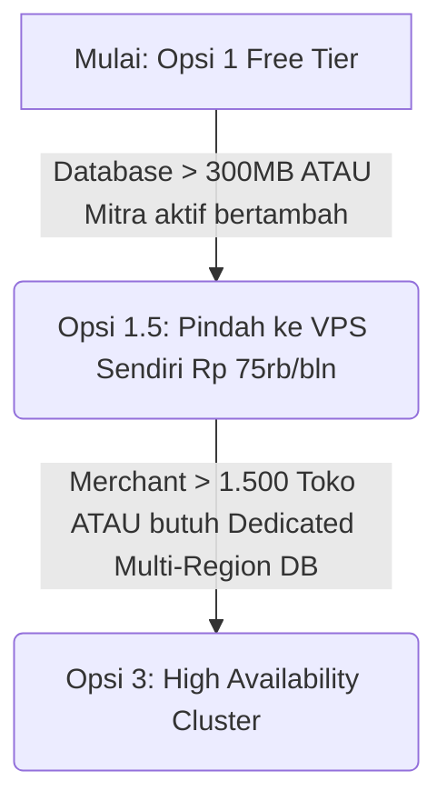

# 🏢 Blueprint Rencana Biaya Operasional & Infrastruktur (CTO Roadmap)
**Mangga POS (SaaS Point of Sales)**  
*Dokumen Strategis untuk Pengambilan Keputusan Infrastruktur, Biaya Operasional (OpEx), Alternatif Penekan Biaya, dan Model Komisi Mitra (20%)*

---

## 📌 1. Prinsip Fundamental Arsitektur & Biaya

Sebagai CTO, arsitektur Mangga POS memiliki **keunggulan kompetitif alami**:
1. **Offline-First & Local DB (Flutter SQLite/Drift):**  
   Aplikasi kasir di HP/tablet memproses transaksi, cetak struk, dan hitung diskon secara **lokal**. Hit ke database cloud hanya terjadi saat sinkronisasi background (*batch sync*), bukan per klik tombol di kasir. Ini menghemat beban compute & bandwidth server hingga **80%**.
2. **Elastic OpEx (Biaya Berbanding Lurus dengan Pendapatan):**  
   Pengeluaran operasional teknologi tidak boleh mendahului *cash flow*. Kenaikan spesifikasi server hanya dilakukan saat ada *trigger* metrik pengguna dan MRR (*Monthly Recurring Revenue*).

---

## ⚖️ 2. Perbandingan 4 Skenario Operasional (OpEx)

Berikut adalah 4 skenario operasional, termasuk **Skenario Khusus Hemat Biaya (Self-Hosted Supabase di VPS)**:

```
┌────────────────────────────────────────────────────────────────────────────────────────┐
│                                 PILIHAN STRATEGI OPEX                                  │
├────────────────────┬─────────────────────────────┬─────────────────────┬───────────────┤
│   OPSI 1: LEAN     │    OPSI 1.5: HACK HEMAT ⭐  │ OPSI 2: CLOUD PRO   │ OPSI 3: SCALE │
│  "Ultra-Bootstrap" │   "Self-Hosted Supabase VPS"│ "Supabase Managed"  │ "Enterprise"  │
│   (0 - 150 User)   │       (100 - 1.500 User)    │ (150 - 1.000 User)  │(1.000 - 5.000)│
│  ~Rp 15rb - 150rb  │     ~Rp 150rb - 250rb /bln  │ ~Rp 500rb - 650rb   │ ~Rp 2,7jt-4,5jt│
└────────────────────┴─────────────────────────────┴─────────────────────┴───────────────┘
```

---

### 🟢 OPSI 1: Ultra-Lean Bootstrap (Biaya Super Minimal)
> **Cocok untuk:** Tahap peluncuran awal, *early adopters*, uji coba pasar dengan 0 – 150 merchant aktif.

| Komponen | Vendor / Service | Tier / Paket | Estimasi Biaya (Bulan) |
| :--- | :--- | :--- | :--- |
| **Database & Auth** | Supabase Cloud | **Free Tier** (500MB DB, 1GB Storage) | Rp 0 |
| **Admin Web Panel** | Vercel | **Hobby Plan (Free)** | Rp 0 |
| **Domain Resmi** | Niagahoster / Namecheap | `.my.id` / `.online` (~Rp 150.000/thn) | ~Rp 12.500 |
| **DNS, CDN & SSL** | Cloudflare | **Free Plan** (DDoS Protection & SSL) | Rp 0 |
| **Struk WhatsApp** | WhatsApp Intent di HP | Menggunakan intent aplikasi WA kasir (tanpa API) | Rp 0 |
| **Email Transaksional** | Resend.com | **Free Tier** (100 email/hari = 3.000/bln) | Rp 0 |
| **Monitoring & Crash** | Firebase Crashlytics | **Free** (Sudah terintegrasi di Flutter) | Rp 0 |
| **Payment Gateway** | Tripay / Midtrans | Biaya per transaksi (dipotong saat ada transaksi) | *Pay-as-you-go* |
| **Total Estimasi OpEx** | | | **~Rp 12.500 – Rp 150.000 / bln** |

- **Kelebihan:** Hampir tanpa resiko biaya tetap (*fixed cost close to zero*).
- **Kekurangan / Risiko:**
  - Supabase Free tier otomatis **pause** jika tidak ada aktivitas selama 7 hari berturut-turut.
  - Kuota database kecil (500 MB).
  - Struk WA mengharuskan kasir memiliki aplikasi WA di tablet/HP kasir.

---

### 🌟 OPSI 1.5: The Smart CTO Hack — Self-Hosted Supabase di VPS (REKOMENDASI TERBAIK PENIKMAT EFISIENSI) 🏆
> **Cocok untuk:** 100 – 1.500 merchant. **Solusi memangkas biaya hingga 80%** dibanding Supabase Cloud Pro, tanpa merubah kode aplikasi Flutter!

| Komponen | Vendor / Service | Tier / Paket | Estimasi Biaya (Bulan) |
| :--- | :--- | :--- | :--- |
| **Database, Auth & Storage** | **VPS Hetzner / IDCloudHost** | **2 vCPU, 4GB RAM, 40GB NVMe** (Coolify/Docker) | **~Rp 65.000 – Rp 95.000** |
| **Admin Web Panel** | Vercel / Hosted di VPS yang sama | **Free / Caching Cloudflare** | Rp 0 |
| **Domain Resmi** | Namecheap / Domainesia | `.com` / `.id` (~Rp 200.000/thn) | ~Rp 17.000 |
| **DNS & Proteksi Web** | Cloudflare | **Free Plan** (DDoS, WAF dasar, SSL) | Rp 0 |
| **WhatsApp Otomatis** | Fonnte / Wablas | **Paket Regular** (Kirim nota otomatis dari server) | ~Rp 85.000 |
| **Email Transaksional** | Resend.com | **Free Tier** (3.000 email/bln) | Rp 0 |
| **Backup Otomatis** | Cloudflare R2 + Cron Dump | **Free Tier R2** (10GB cold storage gratis) | Rp 0 |
| **Uptime Monitor** | BetterStack Uptime | **Free Tier** (Ping alert ke Telegram) | Rp 0 |
| **Total Estimasi OpEx** | | | **~Rp 167.000 – Rp 197.000 / bln** |

- **Kelebihan Luar Biasa:**
  - **KODE FLUTTER & ADMIN WEB 0% BERUBAH:** Semua fungsi Supabase Flutter SDK (Auth, Table, RLS, Storage, Realtime) bekerja 100% identik!
  - **TIDAK ADA AUTO-PAUSE:** Server aktif 24/7/365 tanpa takut project ditidurkan.
  - **Kapasitas 80x Lebih Besar:** Mendapatkan storage 40 GB – 80 GB SSD NVMe (bandingkan dengan Supabase Cloud Free yang hanya 500 MB).
  - **Hemat Ekstrem:** Hanya bayar sewa VPS (~Rp 65rb - 95rb/bulan) daripada $25/bulan (~Rp 400rb/bln) ke Supabase Cloud.
  - **Ping Sangat Cepat (Low Latency):** Server VPS bisa dipilih di Jakarta atau Singapura (latency ke kasir hanya 10ms - 25ms).

---

### 🔵 OPSI 2: Managed Cloud Pro (Supabase Cloud Official)
> **Cocok untuk:** 150 – 1.000 merchant aktif bagi founder yang tidak ingin repot mengelola VPS sama sekali (*zero DevOps maintenance*).

| Komponen | Vendor / Service | Tier / Paket | Estimasi Biaya (Bulan) |
| :--- | :--- | :--- | :--- |
| **Database & Auth** | Supabase Cloud | **Pro Plan** ($25 / bln) | ~Rp 400.000 |
| **Admin Web Panel** | Vercel | **Hobby / Cloudflare Caching** | Rp 0 |
| **Domain Resmi** | Namecheap / Domainesia | `.com` / `.id` (~Rp 250.000/thn) | ~Rp 21.000 |
| **DNS & Proteksi Web** | Cloudflare | **Free Plan** (WAF dasar + CDN caching) | Rp 0 |
| **WhatsApp Otomatis** | Fonnte / Wablas | **Paket Regular** (Kirim nota otomatis dari server) | ~Rp 85.000 – Rp 120.000 |
| **Disaster Backup** | Supabase Backup | Termasuk dalam paket Pro (Daily backup 7 hari) | Rp 0 |
| **Total Estimasi OpEx** | | | **~Rp 506.000 – Rp 650.000 / bln** |

- **Kelebihan:** 100% *managed*, dashboard cantik, ada support resmi Supabase.
- **Kekurangan:** Ada *fixed cost* $25 (Rp 400.000/bln) yang wajib dibayar tiap bulan terlepas ada transaksi atau tidak.

---

### 🔴 OPSI 3: Enterprise Resilience (Skala Trafik Tinggi)
> **Cocok untuk:** 1.000 – 5.000+ merchant aktif, multi-cabang F&B/Retail besar, kepatuhan data SLA 99.99%.

| Komponen | Vendor / Service | Tier / Paket | Estimasi Biaya (Bulan) |
| :--- | :--- | :--- | :--- |
| **Database Engine** | Supabase Dedicated / Cluster VPS | **4-Core / 8GB-16GB RAM Cluster** | ~Rp 1.200.000 |
| **Admin Web Panel** | Vercel Pro | **Team Seat ($20/bln)** | ~Rp 320.000 |
| **WhatsApp Gateway** | Meta Official Cloud API | Bayar per template percakapan (BSP) | ~Rp 800.000 – Rp 1.500.000 |
| **Cold Storage Backup** | Cloudflare R2 / AWS S3 | Export harian dump PostgreSQL terpisah | ~Rp 50.000 |
| **DDoS & Web Security** | Cloudflare Pro | Web Application Firewall (WAF) rule ketat | ~Rp 320.000 |
| **Sistem Ticketing CS** | Crisp.chat / Tawk.to | Live Chat bantuan kasir di dalam aplikasi | Rp 0 – Rp 400.000 |
| **Total Estimasi OpEx** | | | **~Rp 2.700.000 – Rp 4.500.000 / bln** |

---

## 🛠️ 3. Bedah Detail: Alternatif Penekan Biaya Selain Supabase Cloud

```
┌────────────────────────────────────────────────────────────────────────────────────────┐
│                              MATRIKS ALTERNATIF BACKEND                                │
├─────────────────────────┬─────────────────────────┬────────────────────────────────────┤
│   OPSI A (TERBAIK)      │    OPSI B (SERVERLESS)  │   OPSI C (NOT RECOMMENDED)         │
│  Self-Hosted Supabase   │ Neon + Cloudflare R2    │ PocketBase / Firebase              │
│  (VPS Rp 65rb - 100rb)  │ (Free Tier Terpisah)    │ (Rombak Kode / Vendor Lock-in)     │
│  Kode Flutter: 0% Ganti │ Kode Flutter: Perlu API │ Kode Flutter: 100% Ganti Total     │
└─────────────────────────┴─────────────────────────┴────────────────────────────────────┘
```

### A. Opsi A: Self-Hosted Supabase di VPS via Coolify (Pemenang Mutlak)
Supabase adalah kumpulan software open-source (PostgreSQL 15, PostgREST, GoTrue Auth, Realtime server, MinIO S3 storage, dan Kong API Gateway).
- **Rekomendasi Provider VPS:**
  1. **Hetzner Cloud (CX22 / CPX21):** Lokasi Singapura, 2-3 vCPU, 4GB RAM, 40-80GB NVMe disk $\rightarrow$ **~€3.79 - €6.50/bln (Rp 65.000 - Rp 110.000/bln)**.
  2. **IDCloudHost (Cloud VPS):** Lokasi Jakarta, 1-2 vCPU, 2-4GB RAM $\rightarrow$ **~Rp 80.000 - Rp 130.000/bln**.
- **Cara Setup Modern:**
  1. Install panel **Coolify** (PaaS open-source alternatif Heroku/Vercel) di VPS:  
     `curl -fsSL https://cdn.coollabs.io/coolify/install.sh | bash`
  2. Pilih menu *1-Click Service* $\rightarrow$ klik **Supabase**.
  3. Pasang custom domain: `api.manggapos.online`.
  4. Selesai! Anda memiliki seluruh ekosistem Supabase dengan kapasitas disk 40 GB tanpa batas limit.
- **Dampaknya ke Flutter:**  
  Cukup ganti 2 baris di config aplikasi:
  ```dart
  static const String supabaseUrl = 'https://api.manggapos.online';
  static const String supabaseAnonKey = 'eyJh...kunci_anon_vps...';
  ```
  Tidak ada satu baris kode query, RLS, auth, atau storage yang perlu diubah!

### B. Opsi B: Stack Serverless (Neon.tech PostgreSQL + Cloudflare R2)
- Database menggunakan **Neon.tech** (Serverless Postgres dengan free tier 0.5 GB, tidak ada auto-pause).
- Penyimpanan gambar menggunakan **Cloudflare R2** (10 GB gratis, tanpa biaya bandwidth egress).
- *Kekurangan:* Auth dan REST API harus dibangun manual via Edge Functions atau Next.js API Routes (butuh waktu refactoring kode ~3-5 hari).

### C. Opsi C: PocketBase (Single Executable Go + SQLite)
- Konsumsi RAM luar biasa irit (hanya 50 MB RAM).
- *Kenapa tidak disarankan untuk Mangga POS sekarang?*  
  Karena Anda harus **membuang package `supabase_flutter`** dan menulis ulang seluruh kode komunikasi database menggunakan SDK PocketBase. Resiko bug dan waktu pengerjaan tidak sebanding dengan penghematannya.

---

## 📊 4. Analisis Unit Economics & Margin Keuntungan (Dengan Potongan Mitra 20%)

Dalam model pertumbuhan Mangga POS, merchant didapatkan melalui kombinasi **Organik** dan **Mitra Lapangan (Komisi 20%)**. Berikut perbandingan laba bersih dan margin setelah dikurangi potongan hak mitra 20%:

| Skenario | Merchant Aktif | Gross Omset Merchant | Potongan Mitra (20%) | Net Omset Pengembang | Pilihan OpEx Server | Laba Bersih / Bulan | Net Profit Margin (%) |
| :--- | :---: | :---: | :---: | :---: | :---: | :---: | :---: |
| **Validasi Awal** | 20 Merchant | Rp 300.000 / bln | -Rp 60.000 | Rp 240.000 | **Opsi 1 (Free)** ~Rp 12.500 | **+Rp 227.500** | **94.8%** |
| **Traksi Awal (VPS)** | 50 Merchant | Rp 750.000 / bln | -Rp 150.000 | Rp 600.000 | **Opsi 1.5 (VPS)** ~Rp 170.000 | **+Rp 430.000** | **71.6%** |
| **Scale Berjalan** | 200 Merchant | Rp 3.000.000 / bln | -Rp 600.000 | Rp 2.400.000 | **Opsi 1.5 (VPS)** ~Rp 200.000 | **+Rp 2.200.000** | **91.7%** |
| **Growth Nasional** | 500 Merchant | Rp 7.500.000 / bln | -Rp 1.500.000 | Rp 6.000.000 | **Opsi 1.5 (VPS)** ~Rp 250.000 | **+Rp 5.750.000** | **95.8%** |
| **Enterprise Stage** | 1.000 Merchant | Rp 15.000.000 / bln | -Rp 3.000.000 | Rp 12.000.000 | **Opsi 2 / 3** ~Rp 700.000 | **+Rp 11.300.000** | **94.2%** |

> **Analisis CTO:**  
> Meskipun pendapatan terpotong 20% untuk mitra, margin keuntungan bersih pengembang tetap berada di atas **70% hingga 95%**. Komisi mitra 20% ini menggantikan biaya gaji tim sales dan biaya pasang iklan (CAC), sehingga risiko pemasaran pengembang menjadi **0 (Zero Marketing Risk)**.

---

## 🚦 5. Trigger Matrix Kapan Harus Naik Kelas (Kapan Upgrade?)



1. **Dari Opsi 1 (Free) ke Opsi 1.5 (VPS Sendiri):**  
   Lakukan saat toko aktif mencapai 20–25 merchant atau database menyentuh 300 MB. Cukup sewa VPS Rp 75.000/bulan untuk mendapatkan ketenangan penuh tanpa auto-pause dan disk 40 GB.
2. **Dari Opsi 1.5 ke Opsi 3 (Cluster Enterprise):**  
   Lakukan jika transaksi kasir serentak mencapai puluhan ribu per jam dan membutuhkan arsitektur *Read-Replica* di berbagai kota.

---

## 🎯 6. Roadmap Aksi Nyata (Action Plan Saat Ini)

1. **Fase 1 (Minggu Ini):**
   - Upload dan rilis **v1.0.12+23** ke Google Play Store menggunakan Supabase yang sudah terpasang saat ini.
   - Sambungkan domain ke **Cloudflare Free DNS** untuk SSL gratis dan proteksi bot.
2. **Fase 2 (Setelah 15-20 Toko Mulai Aktif):**
   - Sewa VPS Hetzner Singapura (€3.79/bln) atau IDCloudHost Jakarta (~Rp 80rb/bln).
   - Install **Coolify** $\rightarrow$ pasang Supabase Self-Hosted.
   - Pindahkan database dan arahkan `app_constants.dart` Flutter ke VPS tersebut.
   - **Hasil:** Biaya bulanan terkunci hanya **~Rp 170.000/bulan** (sudah termasuk VPS + Domain + Bot WhatsApp), tapi kapasitas toko mampu menampung ribuan merchant dengan margin bersih >70%!
