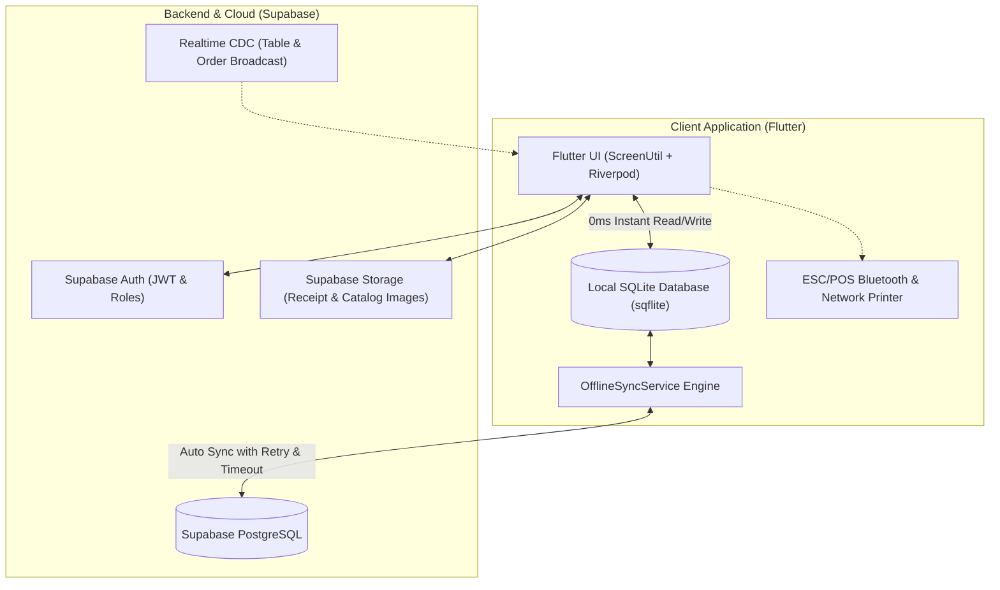

# Master Product Requirements Document (PRD): Mangga POS (DPOS)

**Project Name:** Mangga POS (Digital Point of Sale)  
**Brand Identity:** Mangga POS by Mudahkan.online  
**Version:** 2.6 (Production-Ready with Web Merchant Portal)  
**Date:** Oktober 2026  
**Status:** Live & Aktif di Google Play Store (`online.mudahkan.manggapos`) & Web (`app.mudahkan.online`)  
**Target Platform:** Android (Mobile Phone & Tablet), Web Admin & Merchant Backoffice, PWA Self-Order  

---

## 1. Executive Summary & Visi Produk

### 1.1. Visi Produk
Menghapus hambatan digitalisasi dan operasional bagi 65+ juta pelaku UMKM Indonesia (Toko Kelontong, Ritel Modern, Kafe, Restoran, dan Gerai Kuliner) melalui aplikasi kasir cerdas yang **cepat, tangguh (offline-first), intuitif, dan adaptif** terhadap jenis usaha.

### 1.2. Nilai Utama (Core Value Proposition)
1. **100% Tangguh Offline (Offline-First Resilience):** Kasir tidak boleh terhenti sedetik pun karena internet mati, gangguan sinyal, atau kehabisan kuota. Transaksi, scan barcode, dan cetak struk berjalan lancar secara lokal, lalu otomatis tersinkronisasi ke cloud saat internet kembali.
2. **Dual-Engine Adaptif:** Satu aplikasi yang dapat bertransformasi sesuai tipe usaha:
   - **Mode Ritel / Toko Kelontong:** Dilengkapi 32.000+ database Master Katalog barcode, harga grosir bertingkat, dan scan barcode secepat kilat.
   - **Mode F&B / Kafe & Resto:** Dilengkapi manajemen meja interaktif, workspace waiter, pemesanan QR mandiri (self-order), dan resep bahan baku otomatis potong stok (BOM).
3. **Manajemen Arus Kas & Shift Kasir Transparan:** Mencegah kebocoran uang kasir melalui sistem Buka/Tutup Shift, pencatatan kas operasional (petty cash) berfoto struk, dan rekonsiliasi selisih kas riil.
4. **Pemberdayaan AI Terintegrasi:** Studio foto katalog berteknologi AI untuk membuat foto produk memikat tanpa biaya fotografer, serta asisten analitik pintar untuk wawasan bisnis harian owner.

---

## 2. User Personas & Detailed Workflows

| Persona | Peran Utama | Kebutuhan Kritis |
|---|---|---|
| **Owner (Pemilik Bisnis)** | Pengambil keputusan & pemantau omzet | Pantau omzet harian via HP/Web Admin, audit selisih kasir, monitor peringatan stok menipis, unduh laporan Excel/PDF untuk pajak & akuntansi. |
| **Kasir (Cashier)** | Garda depan transaksi | Checkout cepat (< 10 detik/transaksi), scan barcode akurat, hitung kembalian otomatis, cetak struk Bluetooth, catat pengeluaran kas kecil (petty cash). |
| **Waiter / Pramusaji** | Pelayanan meja pelanggan | Terima pesanan langsung di meja tamu lewat HP waiter, kirim pesanan ke dapur/bar secara realtime, gabung/pindah meja pelanggan. |
| **Dapur / Bar (KDS)** | Pengolah hidangan | Menerima tiket pesanan masuk secara berurutan, status durasi hidangan (hijau/kuning/merah), dan ketersediaan stok bahan baku. |
| **Pelanggan (Self-Service)** | Pembeli mandiri | Scan QR di meja makan, buka menu digital interaktif tanpa download aplikasi, tambah catatan pedas/manis, dan bayar dengan QRIS. |

---

## 3. Fitur Utama & Kebutuhan Fungsional (Feature Specifications)

### 3.1. Mesin Offline-First & Sinkronisasi Cerdas
* **Penyimpanan Lokal Berbasis SQLite (`sqflite`):**
  - Seluruh katalog produk, kategori, metode pembayaran, dan riwayat pesanan dicache di memori lokal HP kasir.
  - Pembacaan katalog produk berkecepatan **0ms** tanpa bergantung latensi jaringan internet.
* **Antrean Pesanan Offline (Offline Orders Queue):**
  - Transaksi yang terjadi saat offline disimpan aman di database lokal dengan status `is_synced = 0`.
  - Struk thermal Bluetooth tetap dapat langsung dicetak saat offline.
* **Auto Background Sync & Health Monitoring:**
  - Background worker memantau status koneksi internet (`connectivity_plus`).
  - Begitu internet terhubung kembali, sistem secara otomatis melakukan batch sync pesanan offline ke Supabase.
  - Dilengkapi banner status interaktif:
    - **Banner Kuning (Offline Mode):** Menampilkan jumlah pesanan tersimpan di HP beserta tombol manual *"Cek & Sync"*.
    - **Banner Biru (Online Pending Sync):** Menampilkan tombol *"Sync"* dengan loading spinner dan proteksi klik ganda.
  - Sanitasi otomatis UUID & Foreign Key (mengubah fallback string seperti `"cash-default"` menjadi `null` yang kompatibel dengan skema Supabase).
  - Feedback visual floating SnackBar dengan status jelas: *Offline*, *Berhasil*, atau *Gagal beserta penjelasan ramah*.

### 3.2. Master Katalog Ritel 32.000+ Produk
* **Database Barcode Siap Pakai:**
  - Dilengkapi lebih dari 32.000 barcode produk FMCG, sembako, minuman kemasan, dan kebutuhan ritel Indonesia.
  - Kasir cukup memindai barcode menggunakan kamera HP atau scanner eksternal; nama produk, kategori, dan estimasi harga jual otomatis terisi.
* **Harga Grosir Bertingkat (Tiered Wholesale Pricing):**
  - Owner dapat menentukan harga bertingkat berdasarkan kuantitas (misal: Beli 1 pcs = Rp 10.000, Beli ≥ 12 pcs = Rp 9.200, Beli ≥ 24 pcs = Rp 8.800).
  - Keranjang belanja kasir otomatis menyesuaikan harga unit saat kuantitas memenuhi ambang batas tier.

### 3.3. Inventori & Resep Bahan Baku (BOM / Bill of Materials)
* **Manajemen Bahan Baku (Raw Ingredients):**
  - Pencatatan stok bahan baku mentah (misal: Biji Kopi dalam gram, Susu UHT dalam ml, Cup Takeaway dalam pcs).
  - Konversi satuan otomatis (kg ke gram, liter ke ml).
* **Resep Menu (Recipe Linkage):**
  - Setiap menu dapat dihubungkan ke resep (contoh: 1 porsi *Es Kopi Susu* = 18 gr Espresso + 120 ml Susu + 20 ml Gula Aren + 1 pcs Cup).
  - Setiap kali transaksi berstatus *Lunas (Paid)*, sistem otomatis memotong stok bahan baku terkait secara proporsional.
* **Purchase Order (PO) & Manajemen Pemasok (Supplier):**
  - Buat surat pesanan pembelian bahan ke pemasok resmi.
  - Proses penerimaan barang (PO Receiving) otomatis menambah stok gudang dan mencatat riwayat harga beli.
* **Stock Opname & Audit Penyesuaian:**
  - Fitur hitung fisik stok berkala dengan pencatatan selisih (variance), nilai kerugian, dan alasan koreksi (rusak, hilang, kedaluwarsa).

### 3.4. Kasir & Pembayaran Cepat (POS Engine)
* **Metode Pembayaran Fleksibel:**
  - Tunai (Cash) dengan tombol nominal cepat (*quick cash chips*) dan hitung kembalian otomatis.
  - QRIS Dinamis & QRIS Statis Merchant (dapat diunggah langsung ke struk).
  - Transfer Bank, Kartu Debit, dan E-Wallet.
* **Split Bill (Pisah Tagihan):**
  - Kemampuan membagi tagihan meja per orang atau memecah item tertentu untuk pembayaran terpisah.
* **Void & Pembatalan Transaksi:**
  - Hak akses otorisasi khusus untuk membatalkan pesanan disertai pencatatan alasan void untuk mencegah kecurangan kasir.
* **Hold / Simpan Keranjang (Draft Orders):**
  - Simpan transaksi sementara jika pelanggan ingin menambah pesanan atau mengambil barang lain tanpa mengganggu antrean pelanggan berikutnya.

### 3.5. Arus Kas Kasir & Manajemen Shift (Cash Flow Control)
* **Buka Shift (Open Shift):**
  - Kasir wajib memasukkan modal uang kas awal (cash float) sebelum mulai melayani transaksi.
* **Kas Masuk & Kas Keluar (Petty Cash Entry):**
  - Catat uang keluar untuk operasional harian (beli es batu, gas elpiji, uang sampah, kasbon karyawan).
  - Wajib melampirkan keterangan dan **foto struk belanja fisik** via kamera HP sebagai bukti audit.
* **Tutup Shift (Close Shift) & Rekonsiliasi Kas:**
  - Hitung total uang tunai fisik yang ada di laci kasir (*actual count*).
  - Sistem membandingkan dengan kas sistem (*expected cash* = Modal Awal + Penjualan Tunai + Kas Masuk - Kas Keluar).
  - Otomatis menghitung dan mencatat **Selisih Kas (Minus / Plus)**.
  - Cetak struk ringkasan tutup shift ke printer Bluetooth.

### 3.6. Mesin Promo & Diskon Cerdas
* **Diskon Fleksibel:**
  - Diskon nominal tetap (Rp) atau persentase (%).
  - Diskon per item produk atau diskon massal seluruh kategori menu.
* **Promo Tebus Murah:**
  - Pelanggan yang membeli produk pemicu (*trigger item*) berhak menebus produk promosi (*reward item*) dengan harga spesial (contoh: Beli Makanan Utama dapat menebus Es Teh seharga Rp 2.000).
* **Promo BOGO (Buy One Get One):**
  - Konfigurasi beli produk X gratis produk Y atau produk yang sama secara otomatis di keranjang kasir.

### 3.7. Manajemen Meja, Waiter Workspace & Menu QR Meja
* **Denah & Sesi Meja Interaktif:**
  - Indikator warna meja: Hijau (Kosong), Oranye/Merah (Terisi), Biru (Menunggu Pembayaran).
  - Pindah meja (*Move Table*) dan gabung meja (*Merge Table*).
* **Workspace Waiter Terdedikasi:**
  - Tampilan khusus pelayan restoran untuk mencatat pesanan tamu langsung dari meja makan via smartphone waiter.
* **Menu Digital & Self-Order QR Meja:**
  - Generator stiker QR Code unik per nomor meja lengkap dengan logo outlet.
  - Pelanggan cukup scan QR via kamera HP (tanpa instal aplikasi) untuk melihat menu berfoto, memesan, dan checkout.

### 3.8. Studio AI & Analitik Cerdas
* **AI Product Photo Enhancer:**
  - Mengubah foto produk biasa yang difoto kasir di atas meja menjadi foto katalog profesional dengan latar belakang studio modern secara otomatis.
* **AI Business Advisor:**
  - Asisten analitis yang menganalisis tren omzet, produk kurang laku (*slow-moving*), jam sibuk toko, dan memberikan saran strategi peningkatan penjualan kepada owner.

### 3.9. Ekosistem Perangkat Keras (Hardware Ecosystem)
* **Printer Kasir Bluetooth & Jaringan:**
  - Support printer thermal 58mm dan 80mm standar protokol ESC/POS.
  - Kustomisasi header struk (logo, nama toko, alamat, kontak) dan footer struk (pesan terima kasih, barcode QRIS).
  - Cetak struk kasir, cetak tiket dapur/bar, dan cetak laporan tutup shift.
* **Nota Digital WhatsApp:**
  - Kirim struk belanja digital format rapi langsung ke nomor WhatsApp pelanggan dalam sekali klik tanpa boros kertas struk.
* **Scanner Barcode & Laci Kas (Cash Drawer):**
  - Kompatibel dengan barcode scanner USB/Bluetooth dan laci uang otomatis (RJ-11).

### 3.10. Web Merchant Backoffice & Analytics Portal (`app.mudahkan.online`)
* **Live Executive Analytics Dashboard (`/merchant`):**
  - Pemantauan metrik penjualan: Total Omzet Bersih, Total Pesanan Selesai, Total Item Terjual, Rata-rata Nilai Belanja (AOV), dan Estimasi Laba Kotor (Gross Profit).
  - Grafik Penjualan Jam-ke-Jam (*Peak Hours*) jam 08:00 - 22:00 untuk optimalisasi shift dan jam sibuk staf.
  - Grafik Tren Penjualan Harian (7 Hari, 30 Hari, dan Bulan Ini).
  - Analisis Distribusi Metode Pembayaran (QRIS, Tunai, Transfer Bank, EDC).
  - Top 5 Produk Terlaris (*Best Seller*) & Peringatan Stok Menipis (stok ≤ 5 unit).
* **Katalog Produk & Bulk Import/Export Excel (`/merchant/products`):**
  - Download template resmi format Excel (`.xlsx`) siap pakai.
  - Fitur **Import Excel Massal** untuk menambahkan atau memperbarui ratusan produk sekaligus hanya dalam hitungan detik.
  - Fitur **Export Excel** seluruh katalog produk toko.
  - Tambah & edit produk langsung dari layar laptop/PC.
* **Riwayat Transaksi Lengkap & Struk Digital (`/merchant/transactions`):**
  - Monitoring transaksi kasir dan pesanan online secara terpadu.
  - Filter status transaksi (Lunas, Pesanan Masuk, Void, Draft) dan pencarian invoice/pelanggan.
  - Rincian struk item pesanan, diskon, dan pajak.
  - Export riwayat transaksi ke Excel.
* **Laporan Keuangan & Rekonsiliasi Pajak (`/merchant/reports`):**
  - Rekapitulasi Penjualan Kotor, Potongan Diskon, Pajak Resto (PB1), dan Penjualan Bersih.
  - Analisis performa antar-outlet untuk bisnis multi-cabang.
  - Export laporan keuangan ke spreadsheet Excel.
* **Pengaturan Toko Online & Generator QR Code Menu (`/merchant/online-shop`):**
  - Konfigurasi profil toko online (`https://pos.mudahkan.online/s/:slug`).
  - Generator gambar QR Code resolusi tinggi untuk dicetak dan dipajang di kasir atau meja makan tamu.
  - Pengaturan nomor WhatsApp penerima pesanan online langsung.
* **Sistem Autentikasi Ganda & Keamanan Data (RBAC):**
  - Login via Google SSO 1-klik atau Email & Password.
  - Isolasi data otomatis berbasis Row-Level Security (RLS) PostgreSQL untuk setiap bisnis pemilik toko.

---

## 4. Arsitektur Teknis & Keamanan Data

### 4.1. Teknologi Utama
* **Frontend:** Flutter SDK 3.x (Multiplatform: Android Phone, Android Tablet, Web).
* **State Management:** Flutter Riverpod (StateNotifierProvider, AsyncValue).
* **Database Lokal:** SQLite (`sqflite`) untuk offline caching transaksi, produk, dan antrean.
* **Backend:** Supabase Cloud (PostgreSQL 15+, PostgREST, Row Level Security, GoTrue Auth).
* **Penyimpanan Berkas:** Supabase Storage (Foto produk, bukti struk kas keluar, barcode QRIS).

### 4.2. Keamanan & Isolasi Data (Multi-Tenant Security)
* **Row Level Security (RLS):** Seluruh tabel transaksi, produk, dan outlet dikunci menggunakan aturan RLS berbasis `business_id` dan `outlet_id`. User outlet A tidak memiliki izin membaca data outlet B.
* **Role-Based Access Control (RBAC):**
  - **Owner:** Hak akses penuh seluruh bisnis, outlet, laporan laba rugi, dan kelola staf.
  - **Manager:** Kelola inventori, ubah harga, pantau staf dan shift harian outlet.
  - **Cashier:** Transaksi kasir, buka/tutup shift, catat petty cash, dan cetak struk.
  - **Waiter:** Input pesanan meja dan kirim tiket ke dapur.

---

## 5. Metrik Keberhasilan & KPI Produk

| Metrik | Target Standar | Cara Pengukuran |
|---|---|---|
| **Kecepatan Transaksi Kasir** | < 10 detik | Dari produk pertama dipilih hingga struk tercetak |
| **Latensi Buka Katalog (Offline/Online)** | 0 - 50 ms | Query SQLite lokal teroptimasi indeks |
| **Tingkat Keberhasilan Sinkronisasi Offline** | > 99.8% | Rasio pesanan lokal yang sukses masuk ke Supabase saat online |
| **Toleransi Kerugian Kasir (Cash Discrepancy)** | 0% kebocoran tanpa catatan | Laporan selisih Close Shift tercatat sistematis |
| **Crash-Free Sessions** | > 99.5% | Firebase Crashlytics telemetry |

---

## 6. Roadmap Pengembangan Mendatang

* [x] **v2.0:** Master Katalog Ritel 32.000+ produk & scan barcode kamera.
* [x] **v2.2:** Resep Bahan Baku (BOM), Purchase Order & Shift Kasir Berfoto.
* [x] **v2.4:** Promo Tebus Murah, BOGO, Menu QR Meja & AI Studio Foto.
* [x] **v2.5:** Engine Offline-First Tangguh (Auto Sync, Banner Interaktif, Sanitasi UUID).
* [x] **v2.6:** Web Merchant Backoffice & Analytics Portal (Live di https://app.mudahkan.online dengan Bulk Import/Export Excel & Realtime Sales Chart).
* [ ] **v2.7:** Integrasi Dynamic QRIS Payment Gateway Nasional (ShopeePay, GoPay, Dana otomatis verifikasi lunas).
* [ ] **v2.8:** Modul CRM & Loyalty Pelanggan (Poin Belanja & Struk Digital WhatsApp otomatis).

