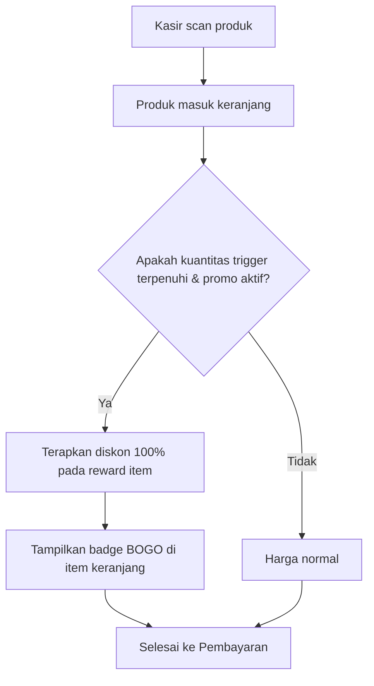
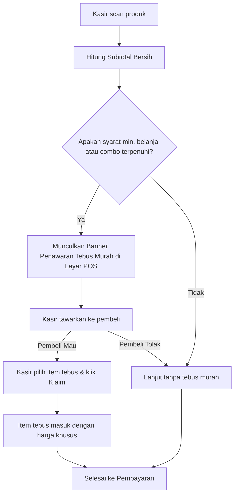

# Product Requirement Document (PRD)
## Modul Promosi: Beli X Gratis Y (BXGY) & Tebus Murah (PWP)

* **Aplikasi:** Mangga POS (Mobile, Tablet, Desktop)
* **Versi Dokumen:** 1.0.0
* **Status:** Roadmap Proposal
* **Target Rilis:** v1.1.0

---

## 1. Ringkasan Eksekutif & Tujuan Bisnis

Fitur promosi terbagi menjadi **2 modul terpisah** dengan mekanisme, tujuan finansial, dan alur kasir yang berbeda:

1. **Beli X Gratis Y (Buy X Get Y / BXGY):**
   * *Tujuan:* Mempercepat perputaran barang (*fast-moving / clearance inventory*), mendorong pelanggan membeli volume lebih banyak per produk.
   * *Karakteristik:* Hadiah berupa produk gratis (Diskon 100%). Logika di keranjang kasir bersifat **otomatis**.
2. **Tebus Murah (Purchase With Purchase / PWP):**
   * *Tujuan:* Menaikkan nilai rata-rata transaksi per nota (*Basket Size / Average Order Value*) dan memberi peluang *cross-selling*.
   * *Karakteristik:* Hadiah berupa hak membeli barang dengan harga khusus / diskon besar (bukan gratis). Alur di kasir membutuhkan **penawaran aktif kasir (upselling pop-up/banner)**.

---

## 2. MODUL A: Beli X Gratis Y (BXGY / BOGO)

### 2.1 Mode Promo
1. **Mode A1: Produk Sama (*Same Product*)**
   * *Contoh:* Beli 2 Kopi Susu, Gratis 1 Kopi Susu.
   * *Alur Kasir:* Ketika kasir menginput 3 Kopi Susu, sistem otomatis menandai 1 item berharga Rp0 (atau memotong diskon 1 item).
2. **Mode A2: Beda Produk (*Cross Product*)**
   * *Contoh:* Beli 1 Sepatu Olahraga, Gratis 1 Pasang Kaos Kaki.
   * *Alur Kasir:* Ketika produk pemicu (*Trigger*) masuk ke keranjang, produk hadiah otomatis masuk ke keranjang kasir dengan harga Rp0 dan label `[GRATIS]`.

### 2.2 Parameter & Aturan Bisnis (Rules Engine)
* **Trigger Otomatis:** Sistem mendeteksi pemenuhan kuantitas secara real-time pada keranjang belanja.
* **Kelipatan (*Multiple Multiplier*):**
  * `isMultipleAllowed = true`: Beli 2 Gratis 1 ➔ Beli 4 Gratis 2 ➔ Beli 6 Gratis 3.
  * `isMultipleAllowed = false`: Beli 4 tetap hanya mendapat Gratis 1.
* **Batas Maksimal Hadiah (*Max Reward Limit*):**
  * Batas maksimum produk gratis per transaksi (misal: Maksimal 2 produk gratis per struk).
* **Masa Berlaku:**
  * Rentang Tanggal: `startDate` s/d `endDate`.
  * Hari Aktif (*Day-of-Week*): Pilihan hari tertentu (contoh: Hanya Jumat, Sabtu, Minggu).
* **Pilihan Varian Hadiah (Opsional):** Jika produk hadiah memiliki opsi varian (misal: gratis donat rasa cokelat atau keju), kasir dapat memilih varian hadiah melalui dialog cepat.

---

## 3. MODUL B: Tebus Murah (Purchase With Purchase / PWP)

### 3.1 Mode Promo
1. **Mode B1: Syarat Minimal Belanja (*Min Spend Subtotal*)**
   * *Contoh:* Belanja minimal Rp50.000 (sebelum item tebus murah), berhak tebus Minyak Goreng 1L seharga Rp10.000 (Harga normal Rp18.000).
2. **Mode B2: Syarat Produk / Combo (*Specific Product Trigger*)**
   * *Contoh:* Beli Paket Burger Special, berhak tebus French Fries hanya seharga Rp5.000 (Harga normal Rp15.000).

### 3.2 Parameter & Aturan Bisnis (Rules Engine)
* **Alur Interaksi Kasir (Upselling Workflow):**
  * Berbeda dari BXGY, produk tebus murah **TIDAK OTOMATIS dimasukkan**, melainkan kasir harus menawari pembeli terlebih dahulu.
  * Ketika subtotal / produk syarat terpenuhi, sistem menampilkan **Banner Penawaran Hijau** di bawah keranjang:
    > `🎁 Pelanggan berhak Tebus Murah! [Lihat Penawaran]`
  * Kasir menekan tombol penawaran, muncul dialog modal daftar produk tebus murah yang memenuhi syarat. Kasir menanyakan ke pembeli, dan jika setuju, kasir menekan tombol **"Klaim Tebus Murah"** untuk memasukkannya ke keranjang.
* **Harga Tebus (*Special Price / Discount*):**
  * Tipe Nominal Tetap (misal: Jadi Rp10.000) atau Persentase Diskon (misal: Diskon 50%).
* **Batas Maksimal Tebus per Nota (*Max Quantity Per Transaction*):**
  * Default: 1 pcs per transaksi (Mencegah kerugian toko dari pemborongan).
* **Aturan Anti-Looping (Subtotal Bersih):**
  * Nilai nominal produk tebus murah **TIDAK DIHITUNG** ke dalam akumulasi minimal belanja untuk mendapatkan promo tebus murah lainnya.
* **Jadwal & Kuota:**
  * Rentang Tanggal: `startDate` s/d `endDate`.
  * Jam Aktif (*Happy Hour*): Misal aktif hanya pukul 14:00 - 17:00.
  * Kuota Alokasi Promo: Batas kuota total stok promo yang disediakan (misal: kuota 50 pcs per hari).

---

## 4. Matriks Perbandingan Fitur

| Parameter | Beli X Gratis Y (BXGY) | Tebus Murah (PWP) |
| :--- | :--- | :--- |
| **Harga Produk Promo** | Selalu Rp0 (Diskon 100%) | Harga khusus miring / diskon spesial (misal: Rp5.000) |
| **Sifat Alur Kasir** | Otomatis masuk / terpotong di keranjang | Kasir menawarkan via Pop-up Banner (*Upselling*) |
| **Syarat Pemicu** | Kuantitas produk tertentu (Beli X pcs) | Minimal belanja rupiah (Rp Z) ATAU Produk Combo |
| **Perlakuan Stok Inventori** | Stok produk gratis **tetap berkurang** 1 | Stok produk tebus murah **tetap berkurang** 1 |
| **Perhitungan Laba / HPP** | HPP barang gratis dibebankan pada transaksi | HPP barang tebus murah dicatat riil |
| **Tampilan Struk Thermal** | Tertera item Rp0 dengan badge `[GRATIS - BOGO]` | Tertera harga asli dicoret / potongan `[TEBUS MURAH]` |
| **Aturan Tumpuk Diskon** | Toggle: Boleh/Tidak digabung voucher nota lain | Toggle: Boleh/Tidak digabung diskon nota lain |

---

## 5. Rencana Skema Data Model (Entity)

### 5.1 Entitas Beli X Gratis Y
```dart
enum BuyXGetYMode {
  sameProduct,
  crossProduct,
}

class BuyXGetYPromo {
  final String id;
  final String name;
  final BuyXGetYMode mode;
  final String triggerProductId;
  final int minBuyQty; // Nilai X
  final String? rewardProductId; // null jika sameProduct
  final int rewardQty; // Nilai Y
  final bool isMultipleAllowed; // Berlaku kelipatan
  final int maxRewardPerTransaction;
  final DateTime startDate;
  final DateTime endDate;
  final List<int>? activeDays; // 1 = Senin, 7 = Minggu
  final bool allowStackWithVoucher;
  final bool isActive;

  const BuyXGetYPromo({
    required this.id,
    required this.name,
    required this.mode,
    required this.triggerProductId,
    required this.minBuyQty,
    this.rewardProductId,
    required this.rewardQty,
    this.isMultipleAllowed = true,
    this.maxRewardPerTransaction = 1,
    required this.startDate,
    required this.endDate,
    this.activeDays,
    this.allowStackWithVoucher = false,
    this.isActive = true,
  });
}
```

### 5.2 Entitas Tebus Murah
```dart
enum TebusMurahMode {
  minSpend,
  productCombo,
}

class TebusMurahPromo {
  final String id;
  final String name;
  final TebusMurahMode mode;
  final double? minSpendAmount; // Nominal syarat jika minSpend
  final String? triggerProductId; // ID produk pemicu jika productCombo
  final String rewardProductId; // Produk yang ditebus
  final double specialPrice; // Harga tebus murah (misal 10000)
  final int maxQtyPerTransaction; // Maksimal pcs per nota (misal 1)
  final DateTime startDate;
  final DateTime endDate;
  final List<int>? activeDays; // Hari aktif
  final String? activeTimeStart; // "14:00"
  final String? activeTimeEnd; // "17:00"
  final int? quotaLimit; // Batas kuota promo toko
  final int currentUsageCount;
  final bool allowStackWithVoucher;
  final bool isActive;

  const TebusMurahPromo({
    required this.id,
    required this.name,
    required this.mode,
    this.minSpendAmount,
    this.triggerProductId,
    required this.rewardProductId,
    required this.specialPrice,
    this.maxQtyPerTransaction = 1,
    required this.startDate,
    required this.endDate,
    this.activeDays,
    this.activeTimeStart,
    this.activeTimeEnd,
    this.quotaLimit,
    this.currentUsageCount = 0,
    this.allowStackWithVoucher = false,
    this.isActive = true,
  });
}
```

---

## 6. Alur Pengalaman Pengguna (User Flow)

### 6.1 Alur Kasir: Beli X Gratis Y (BXGY)


### 6.2 Alur Kasir: Tebus Murah (PWP)


---

## 7. Desain Struk Printer Thermal

Contoh cetak pada struk kasir:
```text
--------------------------------
2x Kopi Susu Aren      Rp 36.000
1x Kopi Susu Aren          Rp 0
   [PROMO Beli 2 Gratis 1]
1x Roti Bakar Cokelat  Rp 20.000
1x Minyak Goreng 1L    Rp 10.000
   [TEBUS MURAH Disc Rp 8.000]
--------------------------------
Subtotal               Rp 66.000
Total Hemat            Rp 26.000
TOTAL AKHIR            Rp 66.000
--------------------------------
```

---

## 8. Laporan & Rekap Owner
* **Laporan Efektivitas Promo:** Menampilkan berapa kali masing-masing promo digunakan.
* **Laporan Biaya Promosi:** Total selisih diskon/subsidi yang dikeluarkan oleh toko.
* **Audit Inventori:** Menjamin barang gratis dan barang tebus murah tetap tercatat pemotongannya secara akurat di kartu stok.
